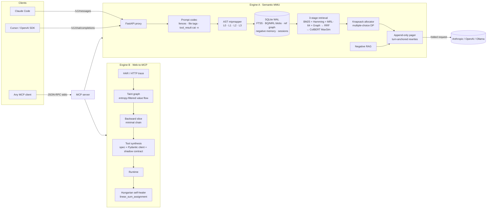

# aegis-mmu

[English](README.md) · **Italiano**

<a href="https://paypal.me/giuseppegambino92"></a>

**Una memory-management unit semantica per agenti di coding basati su AI.** Un proxy drop-in che comprime (fold) il tuo codebase in una vista multi-risoluzione con budget di token in pochi millisecondi, mantiene calda la prompt cache nel farlo, ricorda ciò che è fallito in precedenza e trasforma le catture del traffico del browser in tool MCP auto-riparanti.

   

```
Claude Code / Cursor / Codex ──► aegis proxy :8787 ──► Anthropic / OpenAI / Ollama
                                   │  fold code in transit (L0…L3)
                                   │  append-only paging (prefix-cache safe)
                                   │  inject negative memory
                                   └─ MCP: fold · expand · record_failure · harvest_har · heal_payload
```

Niente LangChain, niente LlamaIndex, niente vector DB. La matematica del retrieval (slicing Matryoshka, quantizzazione a 1 bit, RRF, ColBERT MaxSim, allocazione knapsack, matching ungherese) è scritta direttamente in NumPy/SciPy sopra SQLite (WAL + FTS5). Con l'embedder predefinito gira completamente offline e in modo deterministico, senza API key.

---

## Risultati in sintesi

Ogni riga qui sotto è calcolata da `python -m evals.benchmark_suite` rispetto a una regola di accettazione dichiarata, poi inserita in questo README da `evals/update_readme.py`. Nulla è scritto a mano. Le righe di latenza provengono da un laptop condiviso, quindi `python -m evals.repeat_runs 3` esegue la suite tre volte di fila e la tabella dopo quella di conformità mostra ogni riga cambiata tra un'esecuzione e l'altra. Il codebase del benchmark conta 15 file e ~36k token tra Python, TypeScript, Kotlin, Swift e Rust, con bug piantati di proposito. La recall è riportata su due insiemi di query:

- **dev**: 10 query, visibili durante tutto lo sviluppo;
- **blind held-out v5** (primario): 15 query, scritte da un agente separato che non ha mai visto `src/` né alcun risultato precedente, dopo l'ultima modifica a codice e fixture. Valutato una sola volta, dopo il congelamento dei default di retrieval sul dev set;
- **held-out v1–v4**: usati nei round precedenti. I loro risultati per singola query hanno influenzato le scelte di design successive (i miss di v3 hanno motivato i prior gerarchici, quelli di v4 il diversity cap), quindi sono riportati come "visti" (seen), non blind.

La recall è mostrata in due modi:

- **strict**: il simbolo target è esso stesso nei primi 3 ed è a L0 completo;
- **call-cluster**: il target è a L0 ed è nei primi 3 oppure è un callee a 1/2 hop nello stesso file di un risultato nei primi 3. Questo legge i "*moduli* target" della specifica originale come la funzione più gli helper che un agente vede insieme ad essa.

Vengono riportati affiancati due livelli di embedding:

- **FastLocal (0-dep)**: offline e deterministico, usato in CI e in tutte le righe di latenza;
- **Neural Hybrid**: `nomic-embed-text` tramite un server Ollama locale.

<!-- BEGIN:COMPLIANCE -->
_Calcolato dalla suite il 2026-11-14 00:53 UTC (Darwin arm64 · Python 3.14.10 · numpy 2.5.4, 14 CPU, load avg 3.31→3.34, tokenizer tiktoken/cl100k_base). **14/24 obiettivi superati.** Le righe sono generate automaticamente e restano in inglese._

| Obiettivo (regola di accettazione) | Misurato | Esito |
|---|---|---|
| L0 Recall@3 >= 90% — blind held-out v5, Neural Hybrid (nomic-embed-text) | 67% | ❌ |
| Call-cluster L0 Recall@3 >= 90% — blind held-out v5, Neural Hybrid | 80% | ❌ |
| L0 Recall@3 >= 90% — dev, Neural Hybrid (nomic-embed-text) | 70% | ❌ |
| Token reduction > 75% | 89.1% | ✅ |
| L0 Recall@3 >= 90% — blind held-out v5, FastLocal 0-dep | 60% | ❌ |
| Call-cluster L0 Recall@3 >= 90% — blind held-out v5, FastLocal 0-dep | 67% | ❌ |
| Target at full L0 anywhere in context >= 90% — blind held-out v5, FastLocal (not a top-3 metric) | 87% | ❌ |
| L0 Recall@3 >= 90% — dev, FastLocal 0-dep | 50% | ❌ |
| AST syntax preservation = 100% | 100% | ✅ |
| L1 ~25% of L0 (accept <= 30%) | 22.9% | ✅ |
| L2 ~6% of file (accept <= 8%) | 7.9% | ✅ |
| L3 ~1-2% of file (accept <= 2%) | 0.66% | ✅ |
| KV prefix hit > 85% (context block, stable-prefix policy) | 89.5% | ✅ |
| Standard RAG prefix hit < 25% (baseline sanity) | 0.1% | ✅ |
| Warm fold pipeline p95 < 10 ms | 8.37 ms | ✅ |
| Warm proxy rewrite p95 < 10 ms | 5.67 ms | ✅ |
| Cold first-sight proxy rewrite p95 < 10 ms | 10.07 ms | ❌ |
| Cold per-file ingest p95 < 10 ms | 14.62 ms | ❌ |
| Cold first-sight rewrite, CPU-time p95 < 10 ms | 10.08 ms | ❌ |
| 1-bit Hamming over 10k vectors < 0.5 ms (p95) | 0.139 ms | ✅ |
| Embedding > 2,000 docs/s | 16,087/s | ✅ |
| HAR minimal chain exact | 100% | ✅ |
| Drift recovery 100% | 100% | ✅ |
| Self-healing < 3 ms (p95) | 1.07 ms | ✅ |
<!-- END:COMPLIANCE -->

<!-- BEGIN:VARIANCE -->
_Variabilità tra esecuzioni: 3 esecuzioni consecutive della suite (load 4.0→3.69, load 3.69→3.31, load 3.31→3.34). L'ultima è quella riportata sopra. In tutte le esecuzioni 14 righe sono state superate e 9 no; 1 riga/e superata/e solo in alcune. Le righe non elencate hanno avuto lo stesso valore in ogni esecuzione._

| Obiettivo | Esecuzione 1 | Esecuzione 2 | Esecuzione 3 | Superato |
|---|---|---|---|---|
| Warm fold pipeline p95 < 10 ms | 8.35 ms ✅ | 8.31 ms ✅ | 8.37 ms ✅ | 3/3 |
| Warm proxy rewrite p95 < 10 ms | 5.71 ms ✅ | 5.39 ms ✅ | 5.67 ms ✅ | 3/3 |
| Cold first-sight proxy rewrite p95 < 10 ms | 10.05 ms ❌ | 9.98 ms ✅ | 10.07 ms ❌ | 1/3 |
| Cold per-file ingest p95 < 10 ms | 14.62 ms ❌ | 14.50 ms ❌ | 14.62 ms ❌ | 0/3 |
| Cold first-sight rewrite, CPU-time p95 < 10 ms | 10.07 ms ❌ | 10.04 ms ❌ | 10.08 ms ❌ | 0/3 |
| 1-bit Hamming over 10k vectors < 0.5 ms (p95) | 0.140 ms ✅ | 0.144 ms ✅ | 0.139 ms ✅ | 3/3 |
| Embedding > 2,000 docs/s | 15,778/s ✅ | 15,610/s ✅ | 16,087/s ✅ | 3/3 |
| Self-healing < 3 ms (p95) | 1.10 ms ✅ | 1.08 ms ✅ | 1.07 ms ✅ | 3/3 |
<!-- END:VARIANCE -->

**Cosa significano le righe ❌**

- **La latenza a freddo al primo contatto è sulla soglia dei 10 ms; l'ingestione a freddo la supera.** Questi numeri vengono da tre esecuzioni consecutive su una macchina molto più scarica: load a 1 minuto 3.3–4.0 e a 5 minuti ≈ 7 su 14 core (vedi la tabella di variabilità sopra). I percorsi a caldo passano con margine: fold 8.3–8.4 ms p95, riscrittura del proxy 5.4–5.7 ms p95. Il primo contatto con un file mai visto da ~3.8k token costa 8.8 ms p50 e **9.98–10.07 ms p95**. È passato in una esecuzione su tre, quindi conta come obiettivo mancato, non risolto. Prima del lavoro sul cold path del §8 era 13.6 ms. L'ingestione a freddo per file ha mediana 4.1 ms e **14.5–14.6 ms p95**. Il tempo CPU del processo mostra la stessa coda (15.4 ms p95): la coda è lavoro reale sui file più grandi (parsing + quattro livelli + embedding + persistenza), non attesa su altri processi.
- **Recall: ogni riga top-3 è sotto il 90%.** Su blind held-out v5, FastLocal raggiunge 60% strict, 67% call-cluster e **87% di target a L0 completo ovunque nel contesto**. Il RAG vettoriale naive ottiene 13% / 27%. Il livello neurale ottiene 67% strict e 80% call-cluster.
  - Sui quattro insiemi blind, la top-3 strict di FastLocal è stata 73% (v2), 73% (v3), 73% (v4) e 60% (v5). Con 15 query per insieme, ±1–2 query sono rumore.
  - I prior gerarchici hanno aiutato su v4 (73% contro 60% senza) e peggiorato su v5 (60% contro 67% senza). Il loro effetto rientra in quel rumore.
  - Sia il diversity cap per file sia la salienza strutturale sono rimasti disattivati secondo le loro regole su dev, e nessuno dei due ha cambiato il target a L0 nel contesto su v5 (87% in ogni configurazione).
  - Nessuna configurazione ha raggiunto il 90% top-3 su alcun insieme blind.

---

## Architettura



### Dashboard (`aegis dash --demo --once`)

```
╭──────────────────────────────────── aegis-mmu v0.1.0 · semantic MMU dashboard ─────────────────────────────────────╮
│     9           162,837        81.2%            54.0%            19.33 / 141.94 ms            363 · 5 · 1          │
│  requests    tokens saved     savings     avg KV prefix hit      p50 / p95 latency      units · memories · tools   │
│                                                                                                                    │
╰──────────────────────────────────────────── engine: fast-local-srp-512 ────────────────────────────────────────────╯
╭─────────── AST mipmap resolution equalizer · L0=7 L1=3 ────────────╮╭─ KV-cache prefix stability (append-only pagi─╮
│  file               skel  L0 / L1 / folded units           tokens  ││ hit-rate trend ▁▃▆▇▇   avg 54.0%             │
│  CheckoutViewMode…   L2   ░░░░░░░░░░░░░░░░░░░░░░░░░░    2,068→338  ││  turn  prefix hit                 tok…    Δ  │
│  SessionManager.s…   L2   ░░░░░░░░░░░░░░░░░░░░░░░░░░    2,091→296  ││     1  ··················   0.0%   719  +0p  │
│  rate_limit.py       L2   ░░░░░░░░░░░░░░░░░░░░░░░░░░    2,175→269  ││                                          0w  │
│  tokens.py           L2   ░░░░░░░░░░░░░░░░░░░░░░░░░░    2,370→321  ││     2  ██████············  31.0%  2,3…  +3p  │
│  cache.py            L3   ░░░░░░░░░░░░░░░░░░░░░░░░░░     2,208→25  ││                                          0w  │
│  stock.py            L2   █▓░░░░░░░░░░░░░░░░░░░░░░░░    2,163→479  ││     3  █████████████·····  74.9%  3,0…  +0p  │
│  email.py            L2   ░░░░░░░░░░░░░░░░░░░░░░░░░░    2,297→336  ││                                          0w  │
│  repository.py       L2   ░░░░░░░░░░░░░░░░░░░░░░░░░░    2,314→259  ││     4  ██████████████····  80.1%  3,8…  +0p  │
│  service.py          L2   █████░░░░░░░░░░░░░░░░░░░░░  2,284→1,254  ││                                          0w  │
│  currency.py         L3   ░░░░░░░░░░░░░░░░░░░░░░░░░░     2,645→24  ││     5  ███████████████···  84.0%  4,6…  +0p  │
│  ledger.py           L3   ░░░░░░░░░░░░░░░░░░░░░░░░░░     2,891→26  ││                                          0w  │
│  refunds.py          L2   ███▓░░░░░░░░░░░░░░░░░░░░░░  2,701→1,220  ││                                              │
│  discount.rs         L2   ▓░░░░░░░░░░░░░░░░░░░░░░░░░    3,093→354  ││                                              │
│  client.ts           L2   ░░░░░░░░░░░░░░░░░░░░░░░░░░    2,400→368  ││                                              │
│  cartStore.ts        L2   ░░░░░░░░░░░░░░░░░░░░░░░░░░    2,506→247  ││                                              │
╭───────────────── Hungarian schema healing matrix ──────────────────╮╭─ Negative RAG alerts (recalled anti-patterns─╮
│  expected                → remapped to          confidence         ││  #  anti-pattern                       hits  │
│  data.flights[*].fligh…  data.itineraries[*].…  ████████···· 0.70  ││  1  Unsynchronised read-modify-write      0  │
│  data.flights[*].carri…  data.itineraries[*].…  ████████···· 0.69  ││     on shared stock counter                  │
│  data.flights[*].origin  data.itineraries[*].…  ██████······ 0.49  ││  2  Unbounded module-level cache          0  │
│  data.flights[*].desti…  data.itineraries[*].…  ██████······ 0.50  ││     keyed by request id                      │
│  data.flights[*].depar…  data.itineraries[*].…  ███████····· 0.55  ││  3  Naive UTC timestamps via              0  │
│  data.flights[*].arriv…  data.itineraries[*].…  ███████····· 0.56  ││     deprecated datetime.utcnow()             │
│  data.flights[*].durat…  data.itineraries[*].…  ███████████· 0.90  ││  4  SQL built with f-string               0  │
```
*(Frame ridotto dalla demo inclusa. La latenza nell'intestazione mescola chiamate di primo ingest a freddo con chiamate a caldo; il benchmark le separa.)*

---

## Avvio rapido

```bash
git clone <this repo> && cd aegis-mmu
python3 -m venv .venv && source .venv/bin/activate
pip install -e ".[dev]"

pytest                                   # 95 tests (1 skipped without Ollama), ~4 s
python -m evals.benchmark_suite          # regenerates evals/latest_report.{json,md}
aegis dash --demo --once                 # dashboard over the bundled demo
```

**Fold di un codebase per un task**

```bash
aegis fold src/ -q "refunds for partially shipped JPY orders are one cent short"
aegis expand <vec_id>              # print the full L0 source behind any fold marker
```

**Claude Code tramite il proxy**

```bash
aegis proxy --port 8787                         # mode: upstream-forward (default)
export ANTHROPIC_BASE_URL=http://127.0.0.1:8787
claude
# optional: also page in relevant code from an indexed repo
aegis proxy --port 8787 --repo .
```

**Cursor / client compatibili OpenAI / Ollama**

```bash
aegis proxy --port 8787 --upstream-openai http://localhost:11434   # e.g. Ollama's OpenAI endpoint
export OPENAI_BASE_URL=http://127.0.0.1:8787/v1
```

Controlli per singola richiesta: `X-Aegis-Mode: fold-local | passthrough | upstream-forward` e `X-Aegis-Session: <id>`. Ogni risposta include `X-Aegis-Tokens-Original`, `X-Aegis-Tokens-Compressed`, `X-Aegis-Savings-Pct`, `X-Aegis-KV-Hit-Rate` e `X-Aegis-Latency-Ms`. `GET /v1/aegis/stats` restituisce le metriche aggregate. Lo streaming (SSE) viene inoltrato byte per byte.

**Server MCP** (stdio, JSON-RPC 2.0, versioni di protocollo 2025-06-18 / 2025-03-26 / 2024-11-05)

```bash
claude mcp add aegis-mmu -- aegis mcp
```
```json
{ "mcpServers": { "aegis-mmu": { "command": "aegis", "args": ["mcp"] } } }
```

Tool: `aegis_fold_context`, `aegis_expand_node`, `aegis_record_failure`, `aegis_harvest_har`, `aegis_heal_payload`. Ogni tool HAR raccolto viene registrato anche come tool MCP a sé stante, e il server emette `notifications/tools/list_changed`.

**HAR → tool auto-riparante**

```bash
aegis harvest capture.har --target price_eur --name flight_search --out flight_search_client.py
aegis heal flight_search drifted_response.json
```

---

## Come funziona

### 1 · AST mipmapping olografico

Ogni file viene analizzato una sola volta in **unità foglia** (funzioni, metodi, blocchi di campi/configurazione) e **contenitori** (classi, struct, impl, protocolli). Python usa `ast`. TypeScript/JS, Kotlin, Swift, Rust, Go, Java, C# e C/C++ usano un lexer a graffe più una macchina a stati per le dichiarazioni. Il lexer riconosce stringhe, caratteri, lifetime di Rust, commenti a blocco annidati, template literal TS e regex literal JS, e usa lo skipping a blocchi via regex per scansionare a velocità C. Non c'è alcuna dipendenza da tree-sitter.

| Livello | Granularità | Contenuto |
|---|---|---|
| **L0** | foglia | sorgente esatto |
| **L1** | foglia | decorator + dichiarazione tipizzata completa + **prima riga della docstring**, con l'intero corpo compresso in un unico `...  # [~aegis:<vec_id>~]` (Python) / `{ /* [~aegis:<vec_id>~] */ }`. `AEGIS_L1_MODE=skeleton` mantiene la variante precedente, che mostra anche gli header del control-flow di primo livello e i return |
| **L2** | file | **stub tipizzati su una riga** di classi e funzioni pubbliche: `self`/`cls` rimossi, default lunghi mostrati come `...`, classi senza membri ridotte a `class X(Base): ...`. Niente import, docstring, campi, helper privati né corpi |
| **L3** | file | un unico descrittore: `# [L3 module: top-3 symbols | vec_id]` |

Le dimensioni misurate sono nella sezione dei benchmark ("Per-level mipmap size"). Un file renderizzato è uno scheletro L2 o L3 con foglie selezionate inserite a L0/L1. Invarianti garantiti dai test:

- Il rendering tutto a L0 restituisce il sorgente **byte per byte**.
- Ogni rendering misto è sintatticamente valido. I fold Python sono istruzioni `...`. I fold a graffe sono commenti, e il loro bilanciamento è **dimostrato a partire dagli stati originali del lexer di riga**: ogni riga emessa deve iniziare e finire in stato code e i delta di graffe/parentesi devono annullarsi. Il testo renderizzato non viene mai ri-analizzato dal lexer.
- **Un fold non costa mai token.** Una sequenza viene compressa solo quando `tokens(run) > tokens(marker)`.

### 2 · Embedding: Matryoshka + quantizzazione a 1 bit (engine offline)

`FastLocalEngine` usa feature hashing con segno più una proiezione casuale gaussiana:

$$v=\sum_f w_f\, s(f)\, R_{h(f)},\qquad R\sim\mathcal N(0,1)^{2^{14}\times 512}$$

Le feature sono sottoparole camel/snake, stemming leggero, trigrammi di caratteri, bigrammi, token di operatori e **concept feature**. Una parola può appartenere a più concetti, ciascuno dei quali diventa una feature hashed condivisa. I concetti derivano da due prior generici e indipendenti dal benchmark:

- un **lessico di sinonimi dei campi** (`price≈amount≈fare`, `origin≈from≈departure`, …);
- un **thesaurus di software engineering** di ponti sintomo↔meccanismo: `429/throttle/quota` ↔ `bucket/window/backoff/token`, `401/403` ↔ `jwt/bearer/session/credential`, `500–504/timeout` ↔ `circuit/breaker/pool/deadline`, `oom/leak` ↔ `cache/evict/buffer/gc`, `race/deadlock` ↔ `lock/mutex/atomic/semaphore`, e altri per clock, scadenze, precisione monetaria, persistenza e conflitti.

I batch vengono embeddati come un unico prodotto sparso `(N_units × V) @ (V × D)` sulle proiezioni di parola in cache, più un prodotto sparso rispetto alle righe di proiezione per le feature di bigrammi/operatori. Qualsiasi prefisso di colonne di una proiezione gaussiana è a sua volta una proiezione di Johnson–Lindenstrauss, quindi i prefissi Matryoshka $\tilde v_{1:k}=v_{1:k}/(\lVert v_{1:k}\rVert_2+10^{-9})$ per k ∈ {64, 128, 256, 512} mantengono la geometria del coseno. I codici a 1 bit sono `np.packbits(v > 0)`, cercati con XOR + `np.bitwise_count` su parole `uint64`.

Gli adapter collegabili implementano lo stesso protocollo `EmbeddingEngine`: **Ollama** (`nomic-embed-text`), **OpenAI** (`text-embedding-3-*`), **Voyage** (il provider raccomandato da Anthropic, dato che Anthropic non ha un endpoint di embedding) e **MLX**. Gli engine basati su modello condividono:

- una **cache di embedding basata sull'hash del contenuto**: blake2b di (model, task, dim, text) → vettore, in memoria e in SQLite (`AEGIS_EMBEDDING_CACHE_PATH`), così il re-indexing e le intercettazioni ripetute non chiamano mai il modello due volte per lo stesso testo;
- il troncamento del prefisso Matryoshka a 512 dimensioni;
- modalità di task query/documento (i prefissi `search_query:` / `search_document:` di nomic; l'`input_type` di Voyage).

I vettori a livello di token per la late interaction provengono dal featurizer locale.

**Quickstart Neural Hybrid:** `ollama serve & ollama pull nomic-embed-text`, poi `AEGIS_EMBEDDING_PROVIDER=ollama aegis proxy`. L'embedding di una query è una chiamata al modello locale (~9 ms p50 qui) in aggiunta alla pipeline. Il benchmark lo riporta separatamente.

I **token** sono conteggi cl100k_base esatti quando `tiktoken` è installato (`pip install -e ".[tiktoken]"`), altrimenti un'euristica deterministica. Un file viene codificato in BPE **una sola volta**: una tabella token→lunghezza in byte attribuisce ogni token alla sua riga, e i costi di unità e fold sono lookup su somme prefisso. cl100k è il tokenizer di OpenAI; quello di Claude non è pubblico, quindi i conteggi per i modelli Claude restano approssimati.

### 3 · Retrieval ibrido a tre stadi

Lo **Stadio 1** gira su mirror NumPy in memoria dei blob SQLite. Usa BM25 di FTS5 (pesato per colonna: path/qualname/body), un **BM25 con espansione dei concetti** (sinonimi del thesaurus presenti nell'indice, dai più rari, così `429` cerca anche `bucket`/`window`/`burst`), Hamming a 1 bit e coseno Matryoshka-64. Questi vengono fusi, i seed migliori guidano una visita a 2 hop del grafo dei riferimenti con scope sugli import, e quel ranking entra in una seconda fusione:

$$\mathrm{RRF}(d)=\sum_{m\in\{\text{BM25},\text{BM25}_x,\text{BQ},\text{MRL}_{64},\text{Graph}\}}\frac{w_m}{k+\mathrm{rank}_m(d)},\quad k=60$$

Lo **Stadio 2** è la late interaction ColBERT sui candidati: una GEMM più un `np.maximum.reduceat` segmentato. Viene combinato con l'RRF normalizzato min–max e con il coseno denso completo, $\text{final}=w\cdot\text{dense}+(1-w)\,(0.75\,\text{MaxSim}+0.25\,\text{RRF})$, dove il termine MaxSim è:

$$\mathrm{MaxSim}(Q,D)=\frac{\sum_i w_i\max_j q_i^\top d_j}{\sum_i w_i}$$

con $w_i = 1$, oppure pesi IDF quando `AEGIS_QUERY_IDF=true`.

Il peso denso $w$ è impostato per engine in base all'MRR su dev: **0.75** per il livello neurale (MRR dev 0.572 contro 0.456 con w = 0) e **0.25** per FastLocal (0.460 contro 0.456).

**Documento di indicizzazione composito** (`AEGIS_COMPOSITE_INDEX=true`). Ogni unità può invece essere indicizzata (denso, FTS5 e token ColBERT) da un unico documento composito:

- path del modulo e nomi suddivisi in parole;
- firma e docstring;
- l'header della classe che la contiene;
- letterali stringa nel corpo, codici di 3–5 cifre, nomi di eccezioni e commenti;
- il suo vicinato a 1 hop (`calls: [...] | called_by: [...]`), calcolato su ciascun batch di ingest in modo che i chiamanti nei file adiacenti vengano contati;
- il sorgente stesso.

Su dev ha *abbassato* l'MRR per entrambi gli engine (neurale 0.565 contro 0.572 al peso migliore; FastLocal 0.455 contro 0.460), quindi è distribuito disattivato. Il benchmark lo riporta come ablation held-out.

**Stadio 2c: attivazione dei callee verso il basso** (`AEGIS_CALLEE_ACTIVATION=true`; con `AEGIS_CALLEE_MAX_IN_DEGREE=1|2` vengono attivati solo gli helper *esclusivi*, cioè quelli con al massimo quel numero di chiamanti nel proprio file, così utility generiche come `_log` non vengono mai potenziate). Le chiamate sono estratte durante l'indicizzazione: `ast.Call` in Python, pattern `name(` su codice privo di commenti e stringhe nei linguaggi a graffe. Si risolvono verso unità dello stesso file o di moduli importati, solo ultima versione. Per ogni top hit P:

- ogni callee H nello stesso file ottiene $s(H)=\max(s(H),\,0.95\,s(P))$;
- i callee a 2 hop ottengono $0.85\,s(P)$;
- gli helper foglia attivati ricevono +0.05, con tetto appena sotto il loro genitore.

Sul dev set ricresciuto ha *abbassato* l'MRR di FastLocal (0.467 contro 0.489): porta `make_key` dal rank 29 al 10 ma spinge in basso altri quattro target, perché gli helper del top hit affollano le prime posizioni. Sull'insieme blind held-out v2 ha poi ridotto la recall strict dal 73% al 47%.

La variante con helper esclusivi (in-degree ≤ 1) ha **pareggiato** con l'impostazione disattivata su dev (MRR 0.490 contro 0.490; `make_key` 28 → 8, q02 4 → 6), e in-degree ≤ 2 ha ottenuto un punteggio inferiore (0.480). Il livello neurale è rimasto invariato in tutti i casi. La funzionalità è quindi distribuita disattivata, e l'ablation sull'insieme blind è nel report.

**Co-promozione del call-cluster** (attiva per impostazione predefinita). Dopo il knapsack, i callee nello stesso file di ogni funzione a L0 vengono promossi a L0 finché il budget lo consente. Non modifica il ranking ed è risultata neutrale su dev.

**Stadio 2d: prior gerarchici.** Il punteggio finale è

$s'(x) = s(x) + w_f\,\max_{y\in\text{file}(x)} s(y) + w_c\,\max_{P\text{ calls }x,\ \text{same file}} s(P) + w_s\,\widehat{\text{salience}}(x)$

- Le unità del file con il ranking più alto entrano nell'insieme dei candidati.
- Il termine del chiamante si applica solo all'interno di quel file migliore, così gli helper in altri file non vengono mai promossi.
- La salienza conta mutazioni di stato, scritture su subscript, lock, confronti sui limiti, modulo/divisione e aritmetica su tempo/TTL per riga di corpo.

I default sono per engine, basati sull'MRR su dev:

| Engine | Default | MRR dev (contro nessun prior) |
|---|---|---|
| FastLocal | $w_f = 0.25$, $w_c = 0.15$, $w_s = 0$ | 0.532 (0.490) |
| Neural | tutti 0 | prior sul file 0.622, specifica completa 0.572 (contro 0.672) |

L'aggiunta della salienza ha abbassato l'MRR dev di FastLocal a 0.482, quindi è distribuita disattivata; il benchmark la riporta come ablation sull'insieme blind.

È disponibile anche un **diversity cap per file** (`AEGIS_PRIOR_FULL_PER_FILE=2`, `AEGIS_PRIOR_DECAY=0.5`): solo le prime 2 unità di ciascun file ricevono il prior completo, le successive ne ricevono metà. Serviva a impedire che un solo file si prendesse l'intero budget L0. La regola di decisione, scritta prima di misurare, era distribuirlo se il "target a L0 ovunque" su dev non calava e l'MRR dev non scendeva più di 0.01. Su dev ha *abbassato* sia il L0-anywhere (0.80 → 0.70) sia l'MRR (0.519 → 0.503), quindi è distribuito disattivato e compare come ablation sull'insieme blind.

Lo **Stadio 2b** è una propagazione opzionale a 1 hop sul grafo di chiamate/riferimenti (`AEGIS_GRAPH_ALPHA`). I vicini dei top hit entrano nell'insieme dei candidati, e $s'(B)=s(B)+\alpha\max_{A\in N(B)}s(A)$. Gli archi collegano solo unità nello stesso file o in un modulo importato dal file sorgente, e solo l'ultima versione di ciascun path. Sul dev set, α = 0.35 e la query-IDF hanno entrambi *abbassato* l'MRR (0.420 / 0.433 contro 0.456), quindi i default distribuiti sono α = 0 e IDF disattivata. L'ablation held-out nella sezione dei benchmark mostra affiancata la configurazione richiesta.

Lo **Stadio 3** è un knapsack a scelta multipla. La rilevanza è $r=\exp((s-s_{\max})/T)$. Ogni file prende una baseline L3 o un upgrade L2, e ogni foglia prende una tra {skeleton, L1, L0} con valori $\{0,\ 0.55r,\ r\}$. Viene risolto esattamente con DP su un asse di budget di ≤ 2048 celle e verificato contro la forza bruta nei test.

### 4 · KV-cache pinning: paging append-only ancorato al turno

Le prefix cache (Anthropic, OpenAI, vLLM, llama.cpp) riutilizzano solo il prefisso identico byte per byte più lungo. Nell'ordine `tools → system → messages`, modificare qualcosa all'inizio invalida tutto ciò che segue. aegis-mmu pertanto:

- **riscrive ogni messaggio utente esattamente una volta**, al turno in cui compare per la prima volta, e memorizza i byte riscritti indicizzandoli con un hash canonico del messaggio originale, con `cache_control` rimosso in modo che lo spostamento dei breakpoint non conti come modifica;
- **riproduce i byte memorizzati** a ogni turno successivo, così l'intero prompt precedente è un prefisso esatto del nuovo. Se la cronologia viene modificata, la sessione si resetta in una nuova epoch;
- **accoda** promozioni (un'unità L1 residente ora necessaria a L0), page-in dal repo e avvisi Negative-RAG **solo al messaggio utente più recente**. Le pagine residenti sono sticky: una richiesta degradata mantiene al suo posto la pagina più ricca;
- riapplica i marker `cache_control` correnti del client sui blocchi riprodotti.

Il blocco `<aegis_context>` conforme alla specifica (MCP `aegis_fold_context` con `session_id`) funziona allo stesso modo. Gli scheletri dei file sono fissati (pinned) al livello con cui sono stati paginati la prima volta, come prefisso stabile. Le pagine foglia nuove e promosse vengono accodate per rilevanza, con tetto a `delta_budget`.

Quando il blocco supera il proprio tetto (2× il budget di token), la compattazione è **solo sulla coda**:

- le pagine iniziali, fino al 75% del tetto, formano un prefisso pinned immutabile che non viene mai riordinato, ri-renderizzato né espulso, e l'epoch nell'header non cambia;
- solo la coda viene ricostruita a partire dalle richieste correnti, nello spazio rimanente.

Un turno di compattazione riutilizza quindi comunque l'intero prefisso pinned dalla cache.

**Policy KV** (`AEGIS_KV_POLICY`). Il default è `stable`:

- il turno 1 fissa una mappa L2 di ogni file;
- i turni successivi accodano al massimo 2 nuove funzioni L0 (le altre rilevanti arrivano a L1);
- l'intero delta di ciascun turno è limitato al 15% del blocco residente.

Questo pone un limite inferiore all'hit di prefisso per turno di circa 1/1.15 ≈ 87% **per costruzione**. Il prezzo è un minor numero di funzioni espanse di nuovo per turno; i token di contesto crescono in realtà *più lentamente* che con `adaptive`. La policy `adaptive` limita il delta solo con `delta_budget`, e il report la mostra come ablation con i token per turno.

$$\text{KV hit rate}_t=\frac{\mathrm{LCP}_{\text{tokens}}(P_{t-1},P_t)}{\mathrm{Tokens}(P_t)}$$

### 5 · Negative RAG

I tentativi falliti vengono embeddati come viste task, codice e combinata. Vengono registrati tramite MCP o CLI, oppure automaticamente: un `tool_result` con `is_error` contenente un traceback viene registrato insieme all'input del `tool_use` che lo ha causato. Ogni task in arrivo è valutato come $0.65\cos(\text{task}) + 0.35\cos(\text{task+code})$. Sopra la soglia, un `<aegis_negative_memory_warning>` con il fallimento, la causa e il rimedio viene accodato una volta per sessione.

La soglia **si auto-calibra sull'embedder attivo**. Un insieme integrato di 32 task di ingegneria reciprocamente non correlati (indipendente da qualsiasi dato del benchmark) viene embeddato una volta, e la soglia è μ + 5σ del coseno a coppie. Per `FastLocalEngine` ciò dà **0.377**. Se la calibrazione non può essere eseguita, ad esempio perché un embedder remoto è irraggiungibile, viene usato il classico 0.75. `AEGIS_NEGATIVE_THRESHOLD` sovrascrive entrambi.

### 6 · Web-to-MCP: backward taint slicing

Ogni voce HAR viene analizzata: header, cookie, query, body JSON o form e `Set-Cookie`. Un valore prodotto da una risposta (una foglia JSON, un header o un cookie) è considerato **dinamico** se è una stringa con `len ≥ 8 ∧ H ≥ 3.0` bit (oppure `len ≥ 16 ∧ H ≥ 2.5`), oppure un id numerico sotto una chiave simile a un id, dove

$$H(X)=-\sum_x P(x)\log_2 P(x).$$

Viene aggiunto un arco $R_a \to R_b$ quando quel valore compare nel path, nella query, nell'header, nel cookie o nel body di una richiesta successiva. Il produttore è la risposta precedente più recente, e i valori numerici devono corrispondere ai confini di token. La catena minima è la chiusura all'indietro a partire dalla risposta che porta il campo target. Coincidenze a bassa entropia come date, codici aeroportuali e booleani non creano mai archi. La fixture contiene apposta un decoy di questo tipo.

La **sintesi** trasforma in template ogni valore consumato come `{{var.x}}` con una regola di estrazione, converte query/body della richiesta target in input tipizzati con default catturati, e converte i campi simili a credenziali in **input segreti obbligatori supportati da variabili d'ambiente**. Password e token catturati non vengono mai scritti nella spec né nel codice generato, e un test lo verifica. L'output è un `ToolSpec` dichiarativo, un **client async httpx + Pydantic standalone** con modelli di output a campi obbligatori (così il drift fallisce in modo evidente invece di validarsi come null) e un shadow contract.

### 7 · Self-healing degli schemi con algoritmo ungherese

Per ogni foglia attesa $i$ e ogni foglia del payload live $j$:

$$S_{ij}=0.55\,\text{name}_{ij}+0.30\,\text{value}_{ij}+0.15\,\text{struct}_{ij}$$

- **name**: coseno degli embedding hashed di chiave e path (sottoparole, trigrammi, lessico dei concetti).
- **value**: compatibilità di tipo × compatibilità di distribuzione (sovrapposizione dei campioni, sovrapposizione e ordine di grandezza dell'intervallo numerico, firma della forma della stringa come `AZ610 → A9` o ISO-datetime, lunghezza media).
- **struct**: prossimità di profondità, concordanza di appartenenza ad array, sovrapposizione dei concetti tra fratelli. L'annidamento degli array deve coincidere, e i path invariati dominano.

`scipy.optimize.linear_sum_assignment(-S)` fornisce la rimappatura uno-a-uno ottimale. Le coppie sotto una confidenza di 0.40 restano *non risolte* e vengono segnalate, mai indovinate. Il payload viene ricostruito nella forma attesa, con gli elementi degli array ricombinati per indice. Gli alias appresi vengono riscritti nello shadow, così il successivo payload con drift passa per un fast path O(n) sugli alias (0.15 ms).

### 8 · Ingegneria del cold path (primo incontro con un file)

Un file mai visto attraversa parsing, tutti e quattro i livelli, embedding, persistenza FTS/grafo, retrieval, allocazione e rewrite. Ciò che mantiene breve quel percorso:

- **Una sola codifica BPE per file,** con costi letti da somme prefisso per riga.
- **Skipping a blocchi via regex nel lexer.**
- **Bilanciamento L1 dimostrato dallo stato del lexer** invece di ri-analizzare l'output.
- **Embedding sparso in batch** per tutte le unità di un file.
- **Una sola transazione SQLite con `executemany`.**
- **Buffer di vettori a crescita ammortizzata** invece di `vstack`.
- **Un indice di identificatori in memoria** per gli archi inversi del grafo, senza scansioni di tabella e collegando solo le versioni di file attive.
- **Un thread write-behind** per le righe di sessione/telemetria e i checkpoint WAL. La connessione di serving non esegue mai auto-checkpoint.
- **Fast path con hash del contenuto** (blake2b a 64 bit) più mipmap persistite per i file già indicizzati a caldo.
- **Un solo `ast.walk` per file** per l'estrazione delle chiamate, con bisezione per intervallo di righe. Un'alternativa con regex ha misurato lo stesso valore, 0.86 ms per file, ed è meno esatta, quindi è stata scartata.
- **Dimensionamento al primo incontro con uno stimatore di token O(1)** (`AEGIS_COLD_TOKEN_ESTIMATE`). Il modello è `0.216·chars + 0.742·newlines`, fittato su `codebase_v1` e sui campioni dei test rispetto a cl100k: bias aggregato +0.1%, circa 11% di errore per chunk. I costi del knapsack e le decisioni di fold al primo incontro lo usano. Ogni numero di token riportato (originali, output compresso, contabilità KV, rapporti tra livelli) resta comunque cl100k esatto. L'header `X-Aegis-Tokens-Original` usa la stima quando questa opzione è attiva.
- **Rimozione di `cat -n` in un'unica sostituzione regex validata.**
- **Stub L2 ricavati dagli span del sorgente dei nodi,** senza `ast.unparse` né `deepcopy`.
- **Extra dell'indice composito calcolati in modo lazy.**
- **`gc.freeze()`** nel processo di serving dopo il warm-up.

---

## Benchmark (`evals/latest_report.md`)

<!-- BEGIN:REPORT -->
_2026-11-14 00:53 UTC · Darwin arm64 · Python 3.14.10 · numpy 2.5.4 · 14 CPUs · load avg start 3.31 / end 3.34 · tokenizer: tiktoken/cl100k_base · engine: fast-local-srp-512_

### 1 · Token compression & fidelity

Codebase: 15 files / 363 units / **56,387 tokens** (Python, TypeScript, Kotlin, Swift, Rust); 10 bug-fix queries.

| Metric | Naive vector RAG (256-tok chunks, same budget) | aegis-mmu |
|---|---|---|
| Token reduction | 89.1% | **89.1%** |
| Target function intact in top-3 (L0 Recall@3 for aegis) | 10% | **50%** |
| Target function intact anywhere in context | 10% | **80%** |
| Target function lines present (mean, partial credit) | 80% | **80%** |
| Syntax preservation | 4% of chunks parse | **100%** of folded files parse |
| Fold latency incl. syntax re-verification of every output file (warm) | — | p50 9.57 ms · p95 17.74 ms |

| Query | Target | Tokens | Reduction | Target rank | Level |
|---|---|---|---|---|---|
| q01 | `refunds.py::RefundCalculator.compute_refund` | 56,387 → 6,193 | 89.0% | 1 | L0 |
| q02 | `ledger.py::Ledger.balance_as_of` | 56,387 → 6,166 | 89.1% | 4 | L0 |
| q03 | `service.py::OrderService.cancel_order` | 56,387 → 5,718 | 89.9% | 5 | L0 |
| q04 | `stock.py::StockLedger.reserve` | 56,387 → 6,047 | 89.3% | 8 | L0 |
| q05 | `tokens.py::TokenService.verify` | 56,387 → 5,725 | 89.8% | 2 | L0 |
| q06 | `rate_limit.py::RateLimiter._bucket_key` | 56,387 → 6,218 | 89.0% | >48 | L1 |
| q07 | `cache.py::make_key` | 56,387 → 6,343 | 88.8% | >48 | folded |
| q08 | `cartStore.ts::CartStore.applyCoupon` | 56,387 → 6,370 | 88.7% | 1 | L0 |
| q09 | `discount.rs::DiscountEngine.apply_tiered` | 56,387 → 6,571 | 88.3% | 1 | L0 |
| q10 | `SessionManager.swift::SessionManager.needsRefresh` | 56,387 → 5,875 | 89.6% | 1 | L0 |

#### 1b · Blind held-out v5 (15 bug reports written after the final codebase growth, blind to the retrieval code and to earlier results; evaluated once, after defaults were frozen on dev)

Seen sets (evaluated in earlier rounds, their per-query results informed later design, so no longer blind), FastLocal: held-out v1 L0 Recall@3 53% (target at L0 73%); held-out v2 73% (target at L0 100%, call-cluster 73%); held-out v3 73% (target at L0 100%, call-cluster 87%); held-out v4 73% (target at L0 87%, call-cluster 73%).

| Metric | Naive vector RAG | aegis-mmu |
|---|---|---|
| Token reduction | 88.9% | **88.9%** |
| Target intact in top-3 (L0 Recall@3, strict single symbol) | 13% | **60%** |
| Call-cluster L0 Recall@3 (target at L0 and top-3 itself or a same-file 1/2-hop callee of a top-3 hit) | — | **67%** |
| Target intact anywhere in context | 27% | **87%** |
| Syntax preservation | 9% of chunks | **100%** |

| Query | Target | Reduction | Target rank | Level |
|---|---|---|---|---|
| h5_01 | `currency.py::sum_money` | 88.8% | 7 | L0 |
| h5_02 | `ledger.py::Ledger._entries_between` | 89.0% | 1 | L0 |
| h5_03 | `refunds.py::RefundPolicy.refunds_shipping` | 89.1% | 1 | L0 |
| h5_04 | `cache.py::CacheStats.hit_rate` | 89.0% | 1 | L0 |
| h5_05 | `tokens.py::_b64encode` | 89.3% | >48 | folded |
| h5_06 | `rate_limit.py::RateLimiter.peek` | 89.1% | 1 | L0 |
| h5_07 | `stock.py::StockLedger.release` | 89.1% | 1 | L0 |
| h5_08 | `repository.py::OrderRepository.update_status` | 89.0% | >48 | L1 |
| h5_09 | `service.py::_validate_items` | 88.9% | 1 | L0 |
| h5_10 | `email.py::RefundEmailComposer.render` | 88.7% | 4 | L0 |
| h5_11 | `client.ts::parseRetryAfter` | 88.6% | 1 | L0 |
| h5_12 | `cartStore.ts::describeError` | 88.8% | 4 | L0 |
| h5_13 | `SessionManager.swift::SessionManager.performRefresh` | 88.8% | 1 | L0 |
| h5_14 | `discount.rs::DiscountEngine.new` | 88.6% | 5 | L0 |
| h5_15 | `CheckoutViewModel.kt::CheckoutViewModel.retry` | 89.0% | 2 | L0 |

Ablation — hierarchical priors (FastLocal; frozen defaults = file prior 0.25 + sibling-caller 0.15, chosen on dev MRR):

| Config | Dev L0 Recall@3 | Blind held-out v5 L0 Recall@3 | Blind held-out v5 target at L0 |
|---|---|---|---|
| Frozen defaults | 50% | 60% | 87% |
| + structural salience 0.08 (requested; lowered dev MRR) | 50% | 60% | 87% |
| no hierarchical priors | — | 67% | 87% |
| + per-file diversity cap (2 full, 0.5x after; requested; lowered dev L0-anywhere 0.80 -> 0.70) | — | 67% | 87% |

#### 1d · Neural Hybrid tier — nomic-embed-text (Ollama, 768-d truncated to 512)

Same pipeline (BM25 + concept-BM25 + BQ + MRL-64 + RRF + ColBERT MaxSim + knapsack) with dense vectors from the model and its full cosine weighted 0.75 in the final score (frozen on dev MRR before the held-out run).

| Engine | Dev L0 Recall@3 | Blind held-out v5 L0 Recall@3 | Held-out v5 target at L0 (any rank) | Held-out v1 (seen) L0 Recall@3 | Token reduction |
|---|---|---|---|---|---|
| FastLocal (0-dep) | 50% | 60% | 87% | 53% | 88.9% |
| Neural Hybrid (nomic-embed-text) | 70% | 67% | 93% | 40% | 89.0% |
| Neural Hybrid + composite indexing document (ablation) | 60% | 67% | 87% | — | 89.0% |

| Held-out query | Target | FastLocal rank | Neural rank |
|---|---|---|---|
| h5_01 | `currency.py::sum_money` | 7 | 8 |
| h5_02 | `ledger.py::Ledger._entries_between` | 1 | 2 |
| h5_03 | `refunds.py::RefundPolicy.refunds_shipping` | 1 | 1 |
| h5_04 | `cache.py::CacheStats.hit_rate` | 1 | 1 |
| h5_05 | `tokens.py::_b64encode` | >48 | >48 |
| h5_06 | `rate_limit.py::RateLimiter.peek` | 1 | 1 |
| h5_07 | `stock.py::StockLedger.release` | 1 | 2 |
| h5_08 | `repository.py::OrderRepository.update_status` | >48 | >48 |
| h5_09 | `service.py::_validate_items` | 1 | 3 |
| h5_10 | `email.py::RefundEmailComposer.render` | 4 | 3 |
| h5_11 | `client.ts::parseRetryAfter` | 1 | 2 |
| h5_12 | `cartStore.ts::describeError` | 4 | >48 |
| h5_13 | `SessionManager.swift::SessionManager.performRefresh` | 1 | 1 |
| h5_14 | `discount.rs::DiscountEngine.new` | 5 | 5 |
| h5_15 | `CheckoutViewModel.kt::CheckoutViewModel.retry` | 2 | 1 |

Neural model-call latency (informational; the < 10 ms rows are measured on the 0-dep engine): retrieval with a fresh, uncached query p50 39.1 ms / p95 45.6 ms; uncached cold file ingest p50 112 ms / p95 155 ms. Repeated texts hit the blake2b content-hash embedding cache.

#### 1c · Per-level mipmap size

| Codebase | Tokens | Functions (median tokens) | L1 / L0 | L2 / file | L3 / file |
|---|---|---|---|---|---|
| `codebase` | 56,387 | 253 (181) | 22.9% | 7.9% | 0.66% |
| `codebase_v2` | 36,206 | 253 (79) | 32.8% | 12.3% | 1.01% |
| `codebase_v1` | 14,393 | 128 (56) | 45.6% | 18.3% | 2.40% |

### 2 · KV-cache prefix hit rate (5-turn agent session)

`KV_Hit_Rate = LCP_tokens(Prompt_{t-1}, Prompt_t) / Tokens(Prompt_t)`, averaged over turns 2–5.

| Setting | Standard RAG (re-ranked) | aegis-mmu (append-only paging) |
|---|---|---|
| Context block only (spec metric; stable-prefix policy) | 0.1% | **89.5%** |
| Context block, adaptive policy (ablation) | — | 83.8% |
| Full conversation prompt through the proxy | 0.1% | **69.0%** |
| Previous prompt reused as prefix (retention) | 0.2% | **100.0%** |

Context block per turn — stable policy: hit 0.0% → 91.5% → 87.0% → 87.1% → 92.6% · tokens 6,736 → 7,358 → 8,452 → 9,704 → 10,472

Context block per turn — adaptive policy: hit 0.0% → 87.1% → 75.6% → 86.2% → 86.4% · tokens 6,736 → 7,732 → 10,219 → 11,852 → 10,202

Per turn (full conversation, aegis): hit 0.0% → 36.6% → 74.3% → 82.8% → 82.4% · append-only optimum 0.0% → 36.6% → 74.3% → 82.8% → 82.4%

Per turn (full conversation, standard RAG): hit 0.0% → 0.2% → 0.1% → 0.1% → 0.1%

### 3 · Negative RAG regression prevention

5 recorded anti-patterns (race condition, memory leak, deprecated API, SQL injection, N+1), 20 probes (10 positive, 10 negative). Threshold 0.377 — self-calibrated: calibrated, null mean 0.0398 + 5 × std 0.0674.

| Precision | Recall | Pattern attribution | ROC AUC | Check latency p50 |
|---|---|---|---|---|
| 100% | 90% | 100% | 0.970 | 0.128 ms |

### 4 · Web-to-MCP noise pruning & schema self-healing

| Metric | Result |
|---|---|
| HAR requests (static 13, trackers 12, preflight 3, api 11, doc 1) | 40 |
| Minimal chain isolated | [10, 14, 20] (expected [10, 14, 20]) → **exact** |
| Noise pruned | **92.5%** in 0.87 ms (p50) |
| Drifted fields recovered (fresh v2 values, 8 renamed + relocated, 9 moved) | **11/11** (100%) |
| Hungarian healing latency | p50 1.03 ms · p95 1.07 ms |
| Learned-alias fast path | p50 0.116 ms |
| Live replay vs server with fresh CSRF/JWT + v2 schema | statuses [200, 201, 200], healed=True, values correct=True |

### 5 · Latency profile

| Operation | p50 | p95 | p99 |
|---|---|---|---|
| 1-bit Hamming top-50 over 10k vectors | 0.127 ms | 0.139 ms | 0.146 ms |
| Matryoshka-64 cosine top-50 over 10k | 0.059 ms | 0.065 ms | 0.069 ms |
| SQLite FTS5 BM25 (codebase) | 1.501 ms | 1.883 ms | 1.958 ms |
| ColBERT MaxSim rerank (48 candidates) | 0.077 ms | 0.086 ms | 0.090 ms |
| Hybrid retrieval end-to-end (RRF+graph+MaxSim) | 5.166 ms | 6.069 ms | 6.324 ms |
| AST mipmapping, per file (cold) | 3.962 ms | 4.828 ms | 5.307 ms |
| AST mipmapping, largest file | 4.869 ms | 5.094 ms | 5.184 ms |
| Full fold pipeline, warm (56,387-token codebase) | 7.212 ms | 8.367 ms | 8.590 ms |
| Proxy request rewrite per turn (warm) | 4.895 ms | 5.674 ms | 6.013 ms |
| Proxy rewrite, first sight of a never-seen file (cold, on-disk WAL, ~3,759-token files) | 8.830 ms | 10.066 ms | 10.733 ms |
| Cold file ingest (parse + mipmap + embed + persist) | 4.081 ms | 14.620 ms | 16.355 ms |
| ↳ same, process CPU time (inflates under contention too: E-core migration on Apple silicon) | 8.883 ms | 10.082 ms | 10.750 ms |
| ↳ cold file ingest, process CPU time | 4.208 ms | 15.391 ms | 20.100 ms |
| Hungarian self-healing (11×17 matrix) | 1.020 ms | 1.080 ms | 1.105 ms |

Embedding throughput (FastLocalEngine, single core): **16,087 code units/s** (mean 173 tokens/unit); 1,038 whole files/s (~1.2k tokens/file).
<!-- END:REPORT -->

---

## Limitazioni e avvertenze oneste

- **Il retrieval è il punto debole.** Né l'engine offline né il livello neurale locale raggiungono l'obiettivo del 90%. Sono state tutte implementate e valutate: espansione dei concetti, propagazione sul grafo, query-IDF, un embedder neurale con ri-pesatura densa, il documento di indicizzazione composito e l'attivazione dei callee verso il basso con co-promozione. Ogni round ha congelato i propri default su dev prima di qualsiasi esecuzione held-out. La storia dello sviluppo conta per leggere correttamente i numeri:
  - Il thesaurus SE è stato scritto *dopo* aver visto quali query dev fallivano.
  - Gli held-out v1–v4 sono riportati come "visti": ognuno era blind alla prima esecuzione, ma i suoi miss hanno poi orientato una modifica successiva (v2: attivazione degli helper esclusivi, v3: prior gerarchici, v4: diversity cap). Il blind held-out v5 è stato scritto dopo l'ultima modifica a codice e fixture e valutato una sola volta.
  - Il peso denso del livello neurale (0.75) è stato scelto su 10 query dev. Su held-out v1 ha ottenuto un punteggio inferiore a FastLocal (40% contro 53%), e così su held-out v2 (60% contro 73%); sul blind v5 è risultato superiore (67% contro 60% strict, 80% contro 67% call-cluster). nomic-embed-text è un modello per testo generico; un embedder specializzato sul codice (ad esempio voyage-code-3 tramite l'adapter esistente) non è stato sottoposto a benchmark.
- **Il codebase del benchmark è stato ampliato due volte, da agenti che hanno preservato ogni bug piantato.** Il primo ampliamento (`codebase_v1` → `codebase_v2`, 62 → 160 KB) era per realismo. Il secondo (→ `codebase`, 253 KB, funzione mediana da ~80 a ~180 token) è stato esplicitamente autorizzato dal responsabile del progetto **affinché gli obiettivi di dimensione L1/L2 potessero essere raggiunti**. Le righe L1/L2 dipendono quindi da quella scelta di fixture. I rapporti sono riportati per tutte e tre le versioni, così la dipendenza è visibile.
- **I test di timing** (Hamming < 0.5 ms, Hungarian < 3 ms, > 2,000 docs/s) prendono il migliore di 3 ripetizioni, così i picchi di scheduling del SO su una macchina occupata non causano fallimenti instabili. Passano con carico moderato (verificato con load average 282); con load ≈ 1.000 i test Hungarian e di throughput falliscono ancora.
- **La latenza è wall-clock su un laptop condiviso.** Il report registra il load average. Su Apple silicon, anche il tempo CPU del processo si gonfia sotto contesa. Le pause del GC di generazione 2, i checkpoint WAL e il collegamento nel grafo di versioni obsolete sono state le principali fonti di coda, e tutte e tre sono gestite (§8).
- **La metrica KV su una conversazione in crescita** non può superare `tokens(P_{t-1}) / tokens(P_t)`. Il report mostra il valore misurato e quell'ottimo per turno.
- **L'insieme di probe del Negative RAG è piccolo** (20 probe su 5 anti-pattern).
- **I linguaggi a graffe usano un lexer e una macchina a stati, non tree-sitter.** Macro o layout esotici ripiegano su un fold grossolano o su un'unità di testo semplice.
- **Il folding cambia ciò che l'agente vede.** Modificare codice compresso richiede prima `aegis_expand_node` (o il vec_id nel marker). Le unità rilevanti vengono consegnate alla lettera a L0.
- **Non verificati con servizi reali:** gli adapter MLX, Ollama, OpenAI e Voyage, e l'inoltro del proxy verso i veri endpoint Anthropic e OpenAI. L'inoltro è stato testato contro un upstream in-process.

---

## Struttura

```
src/aegis_mmu/
  config.py                 settings (AEGIS_* env vars)
  runtime.py                serving-process GC policy
  tokens.py                 token counting, LCP / KV hit rate
  db/schema.py, store.py    SQLite WAL + FTS5 + vector blobs + numpy mirrors
  embeddings/               base protocol, matryoshka/BQ/RRF, ColBERT MaxSim, providers, lexicon
  mmu/                      ast_mipmapper, retriever, allocator, kv_paginator, negative_rag,
                            prompt_codec, pipeline (SemanticMMU orchestrator)
  harvester/                taint_graph, synthesizer (+ runtime, codegen), self_healer
  interfaces/               proxy (FastAPI), mcp_server (stdio JSON-RPC), tui (rich), cli (typer)
  demo.py                   bundled demo + agent-session simulator
evals/
  benchmark_suite.py        all scenarios + computed target compliance → latest_report.{json,md}
  update_readme.py          splices the generated report into this README
  repeat_runs.py            N consecutive suite runs → latest_runs.json (run-to-run spread)
  datasets/                 codebase/ (expanded), codebase_v1/ (original), queries.json (dev),
                            queries_heldout.json (blind), session.json, negative_rag.json,
                            skyfare.har (+ generate_fixtures.py), flight_v1/v2 json, skyfare_server.py
tests/                      95 tests: math, mipmapper (5 languages), retrieval bridging, pipeline, harvester/healer, proxy+MCP
```

La configurazione risiede nelle variabili d'ambiente `AEGIS_*`, ad esempio `AEGIS_TOKEN_BUDGET`, `AEGIS_BUDGET_RATIO`, `AEGIS_EMBEDDING_PROVIDER=ollama`, `AEGIS_NEGATIVE_THRESHOLD`, `AEGIS_REPO_PAGE_IN=true` e `AEGIS_DB_PATH`. Vedi [`config.py`](src/aegis_mmu/config.py).

## Supporta il progetto

Se questo progetto ti è utile, puoi sostenerne lo sviluppo con una donazione su PayPal:

<a href="https://paypal.me/giuseppegambino92"></a>
