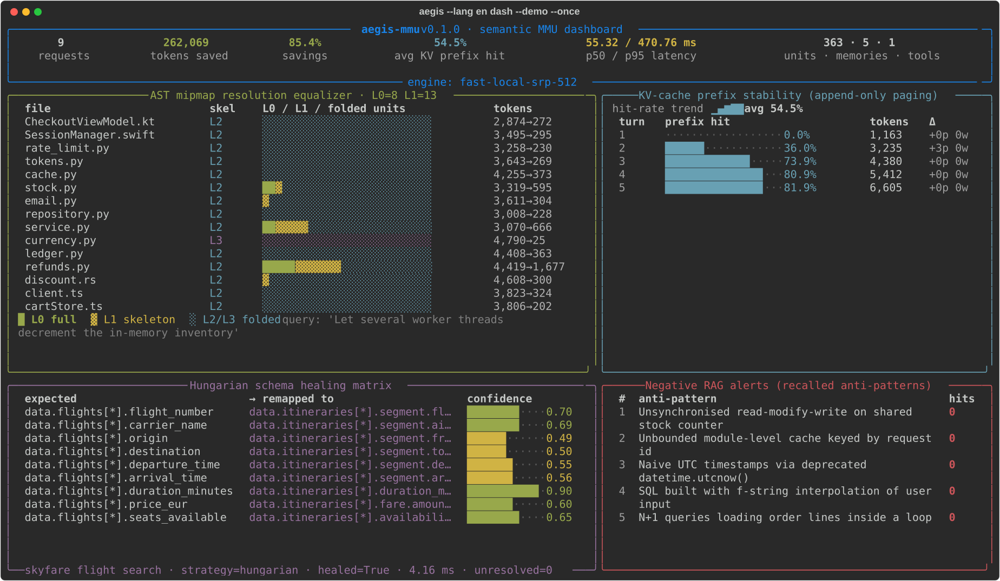
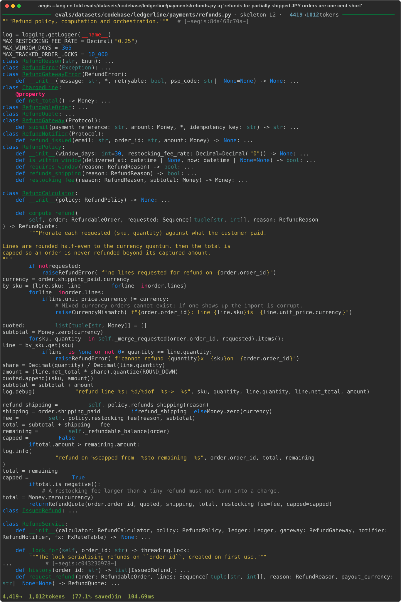
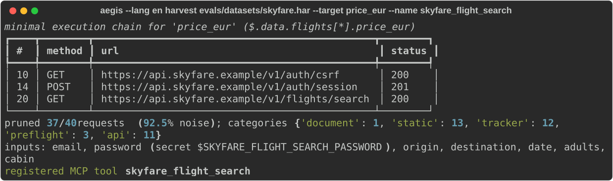
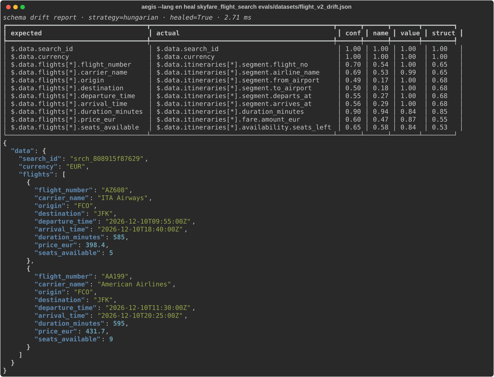
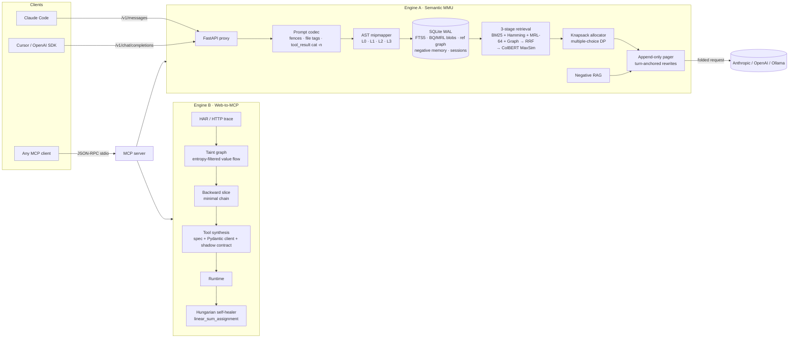

# aegis-mmu

**English** · [Italiano](README.it.md)

**AI coding agents often put whole files into the prompt when the task needs one function.
aegis-mmu is a local proxy that sends them a trimmed view of your code instead: what matters for the task in full, the
rest as signatures they can expand on demand.**

You point Claude Code, Cursor or another OpenAI-compatible client at it by setting
`ANTHROPIC_BASE_URL` or `OPENAI_BASE_URL`. Requests pass through, and the code inside them is
folded on the way. It only appends to the prompt, so the provider's prompt cache keeps hitting. It
also remembers approaches that failed before and warns the agent, and can turn a browser traffic
capture (HAR) into an MCP tool that adapts when the API response changes shape.

It runs locally on SQLite and NumPy, with no API key of its own. It is an experimental research
project: retrieval still misses some targets, and forwarding to the real Anthropic and OpenAI
endpoints has not been verified yet. See
[Limitations & honest caveats](#limitations--honest-caveats).

## Try it in 30 seconds

```bash
git clone https://github.com/giuseppegambino92/aegis-mmu.git && cd aegis-mmu
python3 -m venv .venv && source .venv/bin/activate
pip install -e ".[dev]"

# fold one file around a bug report: the relevant function stays verbatim, the rest becomes signatures
aegis fold evals/datasets/codebase/ledgerline/payments/refunds.py -q "refunds for partially shipped JPY orders are one cent short"
aegis dash --demo --once                 # dashboard over the bundled demo
```

aegis-mmu is not on PyPI; install it from a clone as above.

## What's inside

In technical terms: **a semantic memory-management unit for AI coding agents.**

```
Claude Code / Cursor / Codex ──► aegis proxy :8787 ──► Anthropic / OpenAI / Ollama
                                   │  fold code in transit (L0…L3)
                                   │  append-only paging (prefix-cache safe)
                                   │  inject negative memory
                                   └─ MCP: fold · expand · record_failure · harvest_har · heal_payload
```

No LangChain, no LlamaIndex, no vector DB. The retrieval math (Matryoshka slicing, 1-bit quantization, RRF, ColBERT MaxSim, knapsack allocation, Hungarian matching) is written directly in NumPy/SciPy on top of SQLite (WAL + FTS5). With the default embedder it runs fully offline and deterministically, with no API keys.

---

## Screenshots

Real terminal captures of `aegis` runs on the bundled demo data (`evals/datasets`), recorded with Rich's `Console(record=True)` and exported to SVG. `python scripts/make_screenshots.py` regenerates all of them, in English (`docs/images/en/`) and Italian (`docs/images/it/`), with the offline embedder and a fresh temporary store per command. Timings are measured live on a shared machine and change from run to run.

**Dashboard**: `aegis dash --demo --once`. One frame after the bundled demo (Negative RAG memories, a 5-turn agent session through the proxy rewriter, folds of the demo codebase, a HAR harvest and a drift heal). Top: requests, tokens saved, average KV prefix hit rate, p50/p95 latency. Left: the mipmap level of every file (█ L0 full, ▓ L1 skeleton, ░ L2/L3 folded) and the Hungarian field remapping with confidences. Right: prefix-cache hit rate per turn and the recalled anti-patterns.



**Fold**: `aegis fold evals/datasets/codebase/ledgerline/payments/refunds.py -q "refunds for partially shipped JPY orders are one cent short"`. The unit the bug is in, `RefundCalculator.compute_refund`, stays verbatim at L0, `_lock_for` drops to L1 and everything else is folded to signatures (L2). Every `[~aegis:<vec_id>~]` marker can be restored with `aegis expand <vec_id>`. The last line gives the token reduction and the pipeline latency.



**HAR → MCP tool**: `aegis harvest evals/datasets/skyfare.har --target price_eur --name skyfare_flight_search`. Backward taint slicing keeps the 3 requests that `price_eur` depends on (CSRF token → session → search) and prunes the other 37 of 40 as noise. The password becomes a secret input read from an environment variable, and the tool is registered for the MCP server.



**Schema self-healing**: `aegis heal skyfare_flight_search evals/datasets/flight_v2_drift.json`. The v2 response renamed and re-nested the fields. The Hungarian assignment maps each expected path to its drifted counterpart (`conf` combines name, value and structure similarity), then the payload is printed rewritten to the original contract. That JSON is machine-readable and is never translated.



---

## Results at a glance

Every row below is computed by `python -m evals.benchmark_suite` against a stated acceptance rule, then spliced into this README by `evals/update_readme.py`. Nothing is typed by hand. Latency rows come from a shared laptop, so `python -m evals.repeat_runs 3` runs the suite three times back to back and the table after the compliance table shows every row that changed between runs. The benchmark codebase is 15 files and ~36k tokens across Python, TypeScript, Kotlin, Swift and Rust, with planted bugs. Recall is reported on two query sets:

- **dev**: 10 queries, visible throughout development;
- **blind held-out v5** (primary): 15 queries, written by a separate agent that never saw `src/` or any earlier results, after the last code and fixture change. Evaluated once, after the retrieval defaults were frozen on dev;
- **held-out v1–v4**: used in earlier rounds. Their per-query results influenced later design decisions (v3's misses motivated the hierarchical priors, v4's the diversity cap), so they are reported as "seen", not blind.

Recall is shown two ways:

- **strict**: the target symbol itself is in the top 3 and at full L0;
- **call-cluster**: the target is at L0 and is either in the top 3 or a same-file 1/2-hop callee of a top-3 hit. This reads the original spec's "target *modules*" as the function plus the helpers an agent sees with it.

Two embedding tiers are reported side by side:

- **FastLocal (0-dep)**: offline and deterministic, used in CI and all latency rows;
- **Neural Hybrid**: `nomic-embed-text` through a local Ollama server.

<!-- BEGIN:COMPLIANCE -->
_Computed by the suite on 2026-11-14 00:53 UTC (Darwin arm64 · Python 3.14.10 · numpy 2.5.4, 14 CPUs, load avg 3.31→3.34, tokenizer tiktoken/cl100k_base). **14/24 targets pass.**_

| Target (acceptance rule) | Measured | Pass |
|---|---|---|
| L0 Recall@3 >= 90% — blind held-out v5, Neural Hybrid (nomic-embed-text) | 67% | ❌ |
| Call-cluster L0 Recall@3 >= 90% — blind held-out v5, Neural Hybrid | 80% | ❌ |
| L0 Recall@3 >= 90% — dev, Neural Hybrid (nomic-embed-text) | 70% | ❌ |
| Token reduction > 75% | 89.1% | ✅ |
| L0 Recall@3 >= 90% — blind held-out v5, FastLocal 0-dep | 60% | ❌ |
| Call-cluster L0 Recall@3 >= 90% — blind held-out v5, FastLocal 0-dep | 67% | ❌ |
| Target at full L0 anywhere in context >= 90% — blind held-out v5, FastLocal (not a top-3 metric) | 87% | ❌ |
| L0 Recall@3 >= 90% — dev, FastLocal 0-dep | 50% | ❌ |
| AST syntax preservation = 100% | 100% | ✅ |
| L1 ~25% of L0 (accept <= 30%) | 22.9% | ✅ |
| L2 ~6% of file (accept <= 8%) | 7.9% | ✅ |
| L3 ~1-2% of file (accept <= 2%) | 0.66% | ✅ |
| KV prefix hit > 85% (context block, stable-prefix policy) | 89.5% | ✅ |
| Standard RAG prefix hit < 25% (baseline sanity) | 0.1% | ✅ |
| Warm fold pipeline p95 < 10 ms | 8.37 ms | ✅ |
| Warm proxy rewrite p95 < 10 ms | 5.67 ms | ✅ |
| Cold first-sight proxy rewrite p95 < 10 ms | 10.07 ms | ❌ |
| Cold per-file ingest p95 < 10 ms | 14.62 ms | ❌ |
| Cold first-sight rewrite, CPU-time p95 < 10 ms | 10.08 ms | ❌ |
| 1-bit Hamming over 10k vectors < 0.5 ms (p95) | 0.139 ms | ✅ |
| Embedding > 2,000 docs/s | 16,087/s | ✅ |
| HAR minimal chain exact | 100% | ✅ |
| Drift recovery 100% | 100% | ✅ |
| Self-healing < 3 ms (p95) | 1.07 ms | ✅ |
<!-- END:COMPLIANCE -->

<!-- BEGIN:VARIANCE -->
_Run-to-run spread: 3 consecutive runs of the suite (load 4.0→3.69, load 3.69→3.31, load 3.31→3.34). The last run is the one reported above. In every run 14 rows passed and 9 failed; 1 row(s) passed in some runs and failed in others. Rows not listed had the same value in every run._

| Target | Run 1 | Run 2 | Run 3 | Passed |
|---|---|---|---|---|
| Warm fold pipeline p95 < 10 ms | 8.35 ms ✅ | 8.31 ms ✅ | 8.37 ms ✅ | 3/3 |
| Warm proxy rewrite p95 < 10 ms | 5.71 ms ✅ | 5.39 ms ✅ | 5.67 ms ✅ | 3/3 |
| Cold first-sight proxy rewrite p95 < 10 ms | 10.05 ms ❌ | 9.98 ms ✅ | 10.07 ms ❌ | 1/3 |
| Cold per-file ingest p95 < 10 ms | 14.62 ms ❌ | 14.50 ms ❌ | 14.62 ms ❌ | 0/3 |
| Cold first-sight rewrite, CPU-time p95 < 10 ms | 10.07 ms ❌ | 10.04 ms ❌ | 10.08 ms ❌ | 0/3 |
| 1-bit Hamming over 10k vectors < 0.5 ms (p95) | 0.140 ms ✅ | 0.144 ms ✅ | 0.139 ms ✅ | 3/3 |
| Embedding > 2,000 docs/s | 15,778/s ✅ | 15,610/s ✅ | 16,087/s ✅ | 3/3 |
| Self-healing < 3 ms (p95) | 1.10 ms ✅ | 1.08 ms ✅ | 1.07 ms ✅ | 3/3 |
<!-- END:VARIANCE -->

**What the ❌ rows mean**

- **Cold first-sight latency sits on the 10 ms line; cold ingest misses it.** These numbers come from three back-to-back runs on a much quieter machine: 1-minute load 3.3–4.0 and 5-minute load ≈ 7 on 14 cores (see the spread table above). Warm paths pass with margin: fold 8.3–8.4 ms p95, proxy rewrite 5.4–5.7 ms p95. The first sight of a never-seen ~3.8k-token file costs 8.8 ms p50 and **9.98–10.07 ms p95**. It passed in one run of three, so it counts as a miss, not as solved. Before the cold-path work in §8 it was 13.6 ms. Cold per-file ingest has a median of 4.1 ms and a **14.5–14.6 ms p95**. Process CPU time shows the same tail (15.4 ms p95), so the tail is real work on the largest files (parse + four levels + embedding + persistence), not waiting on other processes.
- **Recall: every top-3 row is below 90%.** On blind held-out v5, FastLocal reaches 60% strict, 67% call-cluster and **87% target at full L0 anywhere in context**. Naive vector RAG gets 13% / 27%. The neural tier gets 67% strict and 80% call-cluster.
  - Across the four blind sets, FastLocal strict top-3 was 73% (v2), 73% (v3), 73% (v4) and 60% (v5). With 15 queries per set, ±1–2 queries is noise.
  - The hierarchical priors helped on v4 (73% vs 60% without) and hurt on v5 (60% vs 67% without). Their effect is within that noise.
  - The per-file diversity cap and structural salience both stayed off by their dev rules, and neither changed L0-in-context on v5 (87% in every configuration).
  - No configuration reached 90% top-3 on any blind set.

---

## Architecture



### Dashboard (`aegis dash --demo --once`)

```
╭──────────────────────────────────── aegis-mmu v0.1.0 · semantic MMU dashboard ─────────────────────────────────────╮
│     9           162,837        81.2%            54.0%            19.33 / 141.94 ms            363 · 5 · 1          │
│  requests    tokens saved     savings     avg KV prefix hit      p50 / p95 latency      units · memories · tools   │
│                                                                                                                    │
╰──────────────────────────────────────────── engine: fast-local-srp-512 ────────────────────────────────────────────╯
╭─────────── AST mipmap resolution equalizer · L0=7 L1=3 ────────────╮╭─ KV-cache prefix stability (append-only pagi─╮
│  file               skel  L0 / L1 / folded units           tokens  ││ hit-rate trend ▁▃▆▇▇   avg 54.0%             │
│  CheckoutViewMode…   L2   ░░░░░░░░░░░░░░░░░░░░░░░░░░    2,068→338  ││  turn  prefix hit                 tok…    Δ  │
│  SessionManager.s…   L2   ░░░░░░░░░░░░░░░░░░░░░░░░░░    2,091→296  ││     1  ··················   0.0%   719  +0p  │
│  rate_limit.py       L2   ░░░░░░░░░░░░░░░░░░░░░░░░░░    2,175→269  ││                                          0w  │
│  tokens.py           L2   ░░░░░░░░░░░░░░░░░░░░░░░░░░    2,370→321  ││     2  ██████············  31.0%  2,3…  +3p  │
│  cache.py            L3   ░░░░░░░░░░░░░░░░░░░░░░░░░░     2,208→25  ││                                          0w  │
│  stock.py            L2   █▓░░░░░░░░░░░░░░░░░░░░░░░░    2,163→479  ││     3  █████████████·····  74.9%  3,0…  +0p  │
│  email.py            L2   ░░░░░░░░░░░░░░░░░░░░░░░░░░    2,297→336  ││                                          0w  │
│  repository.py       L2   ░░░░░░░░░░░░░░░░░░░░░░░░░░    2,314→259  ││     4  ██████████████····  80.1%  3,8…  +0p  │
│  service.py          L2   █████░░░░░░░░░░░░░░░░░░░░░  2,284→1,254  ││                                          0w  │
│  currency.py         L3   ░░░░░░░░░░░░░░░░░░░░░░░░░░     2,645→24  ││     5  ███████████████···  84.0%  4,6…  +0p  │
│  ledger.py           L3   ░░░░░░░░░░░░░░░░░░░░░░░░░░     2,891→26  ││                                          0w  │
│  refunds.py          L2   ███▓░░░░░░░░░░░░░░░░░░░░░░  2,701→1,220  ││                                              │
│  discount.rs         L2   ▓░░░░░░░░░░░░░░░░░░░░░░░░░    3,093→354  ││                                              │
│  client.ts           L2   ░░░░░░░░░░░░░░░░░░░░░░░░░░    2,400→368  ││                                              │
│  cartStore.ts        L2   ░░░░░░░░░░░░░░░░░░░░░░░░░░    2,506→247  ││                                              │
╭───────────────── Hungarian schema healing matrix ──────────────────╮╭─ Negative RAG alerts (recalled anti-patterns─╮
│  expected                → remapped to          confidence         ││  #  anti-pattern                       hits  │
│  data.flights[*].fligh…  data.itineraries[*].…  ████████···· 0.70  ││  1  Unsynchronised read-modify-write      0  │
│  data.flights[*].carri…  data.itineraries[*].…  ████████···· 0.69  ││     on shared stock counter                  │
│  data.flights[*].origin  data.itineraries[*].…  ██████······ 0.49  ││  2  Unbounded module-level cache          0  │
│  data.flights[*].desti…  data.itineraries[*].…  ██████······ 0.50  ││     keyed by request id                      │
│  data.flights[*].depar…  data.itineraries[*].…  ███████····· 0.55  ││  3  Naive UTC timestamps via              0  │
│  data.flights[*].arriv…  data.itineraries[*].…  ███████····· 0.56  ││     deprecated datetime.utcnow()             │
│  data.flights[*].durat…  data.itineraries[*].…  ███████████· 0.90  ││  4  SQL built with f-string               0  │
```
*(Trimmed frame from the bundled demo. Its header latency mixes cold first-ingest calls with warm ones; the benchmark separates them.)*

---

## Quickstart

```bash
git clone https://github.com/giuseppegambino92/aegis-mmu.git && cd aegis-mmu
python3 -m venv .venv && source .venv/bin/activate
pip install -e ".[dev]"

pytest                                   # 107 tests (1 skipped without Ollama), ~4 s
python -m evals.benchmark_suite          # regenerates evals/latest_report.{json,md}
aegis dash --demo --once                 # dashboard over the bundled demo
python scripts/make_screenshots.py       # regenerates docs/images/{en,it}/*.svg from real runs
```

**Output language (English / Italian)**

```bash
aegis --lang it dash --demo --once       # one command in Italian
export AEGIS_LANG=it                     # or every command; --lang wins over AEGIS_LANG
aegis --lang it fold --help              # --help texts are translated too
```

`--lang en|it` (or `AEGIS_LANG`) picks the language of human-readable output: status lines, table titles and headers, the dashboard, and the `--help` descriptions. The default is English. Machine-readable output is never translated: `--json`, `aegis stats`, MCP and proxy payloads, the Negative RAG blocks injected into prompts, generated clients and the benchmark report. Typer's own strings (`Usage`, `Options`, `[required]`, parse errors) also stay in English.

**Fold a codebase for a task**

```bash
aegis fold src/ -q "refunds for partially shipped JPY orders are one cent short"
aegis expand <vec_id>              # print the full L0 source behind any fold marker
```

**Claude Code through the proxy**

```bash
aegis proxy --port 8787                         # mode: upstream-forward (default)
export ANTHROPIC_BASE_URL=http://127.0.0.1:8787
claude
# optional: also page in relevant code from an indexed repo
aegis proxy --port 8787 --repo .
```

**Cursor / OpenAI-compatible clients / Ollama**

```bash
aegis proxy --port 8787 --upstream-openai http://localhost:11434   # e.g. Ollama's OpenAI endpoint
export OPENAI_BASE_URL=http://127.0.0.1:8787/v1
```

Per-request controls: `X-Aegis-Mode: fold-local | passthrough | upstream-forward` and `X-Aegis-Session: <id>`. Every response carries `X-Aegis-Tokens-Original`, `X-Aegis-Tokens-Compressed`, `X-Aegis-Savings-Pct`, `X-Aegis-KV-Hit-Rate` and `X-Aegis-Latency-Ms`. `GET /v1/aegis/stats` returns aggregates. Streaming (SSE) is passed through byte-for-byte.

**MCP server** (stdio, JSON-RPC 2.0, protocol versions 2025-06-18 / 2025-03-26 / 2024-11-05)

```bash
claude mcp add aegis-mmu -- aegis mcp
```
```json
{ "mcpServers": { "aegis-mmu": { "command": "aegis", "args": ["mcp"] } } }
```

Tools: `aegis_fold_context`, `aegis_expand_node`, `aegis_record_failure`, `aegis_harvest_har`, `aegis_heal_payload`. Every harvested HAR tool is also registered as its own MCP tool, and the server emits `notifications/tools/list_changed`.

**HAR → self-healing tool**

```bash
aegis harvest capture.har --target price_eur --name flight_search --out flight_search_client.py
aegis heal flight_search drifted_response.json
```

---

## How it works

### 1 · Holographic AST mipmapping

Each file is parsed once into **leaf units** (functions, methods, field/config blocks) and **containers** (classes, structs, impls, protocols). Python uses `ast`. TypeScript/JS, Kotlin, Swift, Rust, Go, Java, C# and C/C++ use a brace lexer plus a declaration state machine. The lexer understands strings, chars, Rust lifetimes, nested block comments, TS template literals and JS regex literals, and uses regex bulk-skipping to scan at C speed. There is no tree-sitter dependency.

| Level | Granularity | Content |
|---|---|---|
| **L0** | leaf | exact source |
| **L1** | leaf | decorators + full typed declaration + **first docstring line**, with the whole body folded into one `...  # [~aegis:<vec_id>~]` (Python) / `{ /* [~aegis:<vec_id>~] */ }`. `AEGIS_L1_MODE=skeleton` keeps the older variant, which also shows top-level control-flow headers and returns |
| **L2** | file | **one-line typed stubs** of public classes and functions: `self`/`cls` dropped, long defaults shown as `...`, member-less classes collapsed to `class X(Base): ...`. No imports, docstrings, fields, private helpers or bodies |
| **L3** | file | a single descriptor: `# [L3 module: top-3 symbols | vec_id]` |

Measured sizes are in the benchmark section ("Per-level mipmap size"). A rendered file is an L2 or L3 skeleton with selected leaves spliced in at L0/L1. Invariants enforced by the tests:

- All-L0 rendering returns the source **byte-for-byte**.
- Every mixed rendering parses. Python folds are `...` statements. Brace folds are comments, and their balance is **proven from the original line lexer states**: every emitted line must start and end in code state and brace/paren deltas must net to zero. Rendered text is never re-lexed.
- **A fold never costs tokens.** A run is folded only when `tokens(run) > tokens(marker)`.

### 2 · Embeddings: Matryoshka + 1-bit quantization (offline engine)

`FastLocalEngine` uses signed feature hashing plus a Gaussian random projection:

$$v=\sum_f w_f\, s(f)\, R_{h(f)},\qquad R\sim\mathcal N(0,1)^{2^{14}\times 512}$$

The features are camel/snake subwords, light stems, char trigrams, bigrams, operator tokens and **concept features**. A word may belong to several concepts, each becoming a shared hashed feature. Concepts come from two generic, benchmark-agnostic priors:

- a **field-synonym lexicon** (`price≈amount≈fare`, `origin≈from≈departure`, …);
- a **software-engineering thesaurus** of symptom↔mechanism bridges: `429/throttle/quota` ↔ `bucket/window/backoff/token`, `401/403` ↔ `jwt/bearer/session/credential`, `500–504/timeout` ↔ `circuit/breaker/pool/deadline`, `oom/leak` ↔ `cache/evict/buffer/gc`, `race/deadlock` ↔ `lock/mutex/atomic/semaphore`, and others for clocks, expiry, money precision, persistence and conflicts.

Batches are embedded as one sparse `(N_units × V) @ (V × D)` product over cached word projections, plus one sparse product against the projection rows for bigram/operator features. Any column prefix of a Gaussian projection is itself a Johnson–Lindenstrauss projection, so the Matryoshka prefixes $\tilde v_{1:k}=v_{1:k}/(\lVert v_{1:k}\rVert_2+10^{-9})$ for k ∈ {64, 128, 256, 512} keep the cosine geometry. 1-bit codes are `np.packbits(v > 0)`, searched with XOR + `np.bitwise_count` over `uint64` words.

Pluggable adapters implement the same `EmbeddingEngine` protocol: **Ollama** (`nomic-embed-text`), **OpenAI** (`text-embedding-3-*`), **Voyage** (Anthropic's recommended provider, since Anthropic has no embeddings endpoint) and **MLX**. Model-backed engines share:

- a **content-hash embedding cache**: blake2b of (model, task, dim, text) → vector, in memory and in SQLite (`AEGIS_EMBEDDING_CACHE_PATH`), so re-indexing and repeated intercepts never call the model twice for the same text;
- Matryoshka prefix truncation to 512 dims;
- query/document task modes (nomic's `search_query:` / `search_document:` prefixes; Voyage's `input_type`).

Token-level vectors for late interaction come from the local featurizer.

**Neural Hybrid quickstart:** `ollama serve & ollama pull nomic-embed-text`, then `AEGIS_EMBEDDING_PROVIDER=ollama aegis proxy`. A query embedding is one local model call (~9 ms p50 here) on top of the pipeline. The benchmark reports this separately.

**Tokens** are exact cl100k_base counts when `tiktoken` is installed (`pip install -e ".[tiktoken]"`), otherwise a deterministic heuristic. A file is BPE-encoded **once**: a token→byte-length table attributes every token to its line, and unit and fold costs are prefix-sum lookups. cl100k is OpenAI's tokenizer; Claude's is not public, so counts for Claude models remain approximate.

### 3 · Three-stage hybrid retrieval

**Stage 1** runs on in-memory NumPy mirrors of the SQLite blobs. It uses FTS5 BM25 (column-weighted path/qualname/body), a **concept-expanded BM25** (thesaurus siblings that occur in the index, rarest first, so `429` also searches `bucket`/`window`/`burst`), 1-bit Hamming and Matryoshka-64 cosine. These are fused, the top seeds drive a 2-hop walk over the import-scoped reference graph, and that ranking joins a second fusion:

$$\mathrm{RRF}(d)=\sum_{m\in\{\text{BM25},\text{BM25}_x,\text{BQ},\text{MRL}_{64},\text{Graph}\}}\frac{w_m}{k+\mathrm{rank}_m(d)},\quad k=60$$

**Stage 2** is ColBERT late interaction over the candidates: one GEMM plus a segmented `np.maximum.reduceat`. It is blended with min–max-normalized RRF and the full dense cosine, $\text{final}=w\cdot\text{dense}+(1-w)\,(0.75\,\text{MaxSim}+0.25\,\text{RRF})$, where the MaxSim term is:

$$\mathrm{MaxSim}(Q,D)=\frac{\sum_i w_i\max_j q_i^\top d_j}{\sum_i w_i}$$

with $w_i = 1$, or IDF weights when `AEGIS_QUERY_IDF=true`.

Dense weight $w$ is set per engine from dev MRR: **0.75** for the neural tier (dev MRR 0.572 vs 0.456 at w = 0) and **0.25** for FastLocal (0.460 vs 0.456).

**Composite indexing document** (`AEGIS_COMPOSITE_INDEX=true`). Each unit can instead be indexed (dense, FTS5 and ColBERT tokens) from one composite document:

- module path and names split into words;
- signature and docstring;
- the enclosing class header;
- body string literals, 3–5-digit codes, exception names and comments;
- its 1-hop neighbourhood (`calls: [...] | called_by: [...]`), computed across each ingest batch so callers in sibling files count;
- the source itself.

On dev it *lowered* MRR for both engines (neural 0.565 vs 0.572 at the best weight; FastLocal 0.455 vs 0.460), so it ships off. The benchmark reports it as a held-out ablation.

**Stage 2c: downward callee activation** (`AEGIS_CALLEE_ACTIVATION=true`; with `AEGIS_CALLEE_MAX_IN_DEGREE=1|2`, only *exclusive* helpers, those with at most that many callers in their file, are activated, so generic utilities such as `_log` are never boosted). Calls are extracted while indexing: `ast.Call` in Python, `name(` patterns on comment- and string-free code in brace languages. They resolve to same-file or imported-module units, latest version only. For each top hit P:

- every same-file callee H gets $s(H)=\max(s(H),\,0.95\,s(P))$;
- 2-hop callees get $0.85\,s(P)$;
- activated leaf helpers get +0.05, capped just below their parent.

On the regrown dev set it **lowered** FastLocal MRR (0.467 vs 0.489): it lifts `make_key` from rank 29 to 10 but pushes four other targets down, because the top hit's helpers crowd the top ranks. On the blind held-out v2 set it then cut strict recall from 73% to 47%.

The exclusive-helper variant (in-degree ≤ 1) **tied** the off setting on dev (MRR 0.490 vs 0.490; `make_key` 28 → 8, q02 4 → 6), and in-degree ≤ 2 scored lower (0.480). Neural was unchanged throughout. The feature therefore ships off, and the blind-set ablation is in the report.

**Call-cluster co-promotion** (on by default). After the knapsack, the same-file callees of every L0 function are upgraded to L0 while the budget allows. It doesn't change ranking, and it was neutral on dev.

**Stage 2d: hierarchical priors.** The final score is

$s'(x) = s(x) + w_f\,\max_{y\in\text{file}(x)} s(y) + w_c\,\max_{P\text{ calls }x,\ \text{same file}} s(P) + w_s\,\widehat{\text{salience}}(x)$

- The units of the top-ranked file join the candidate set.
- The caller term applies only inside that top file, so helpers in other files are never lifted.
- Salience counts state mutation, subscript writes, locks, boundary comparisons, modulo/division and time/TTL arithmetic per body line.

Defaults are per engine, from dev MRR:

| Engine | Defaults | Dev MRR (vs no priors) |
|---|---|---|
| FastLocal | $w_f = 0.25$, $w_c = 0.15$, $w_s = 0$ | 0.532 (0.490) |
| Neural | all 0 | file prior 0.622, full spec 0.572 (vs 0.672) |

Adding salience lowered FastLocal's dev MRR to 0.482, so it ships off; the benchmark reports it as a blind-set ablation.

A **per-file diversity cap** (`AEGIS_PRIOR_FULL_PER_FILE=2`, `AEGIS_PRIOR_DECAY=0.5`) is also available: only the top 2 units of each file get the full prior, and later ones get half. It was meant to stop one file from taking the whole L0 budget. The decision rule, written down before measuring, was to ship it if dev "target at L0 anywhere" didn't drop and dev MRR fell by no more than 0.01. On dev it *lowered* L0-anywhere (0.80 → 0.70) and MRR (0.519 → 0.503), so it ships off and appears as a blind-set ablation.

**Stage 2b** is an optional 1-hop call/reference-graph propagation (`AEGIS_GRAPH_ALPHA`). Neighbours of the top hits join the candidate set, and $s'(B)=s(B)+\alpha\max_{A\in N(B)}s(A)$. Edges only connect units in the same file or in a module the source file imports, and only the latest version of each path. On the dev set, α = 0.35 and query-IDF both *lowered* MRR (0.420 / 0.433 vs 0.456), so the shipped defaults are α = 0 and IDF off. The held-out ablation in the benchmark section shows the requested configuration side by side.

**Stage 3** is a multiple-choice knapsack. Relevance is $r=\exp((s-s_{\max})/T)$. Each file takes an L3 baseline or an L2 upgrade, and each leaf takes one of {skeleton, L1, L0} with values $\{0,\ 0.55r,\ r\}$. It is solved exactly by DP over a ≤ 2048-cell budget axis and checked against brute force in the tests.

### 4 · KV-cache pinning: append-only, turn-anchored paging

Prefix caches (Anthropic, OpenAI, vLLM, llama.cpp) reuse only the longest byte-identical prefix. In order `tools → system → messages`, editing anything early invalidates everything after it. aegis-mmu therefore:

- **rewrites each user message exactly once**, on the turn it first appears, and stores the rewritten bytes keyed by a canonical hash of the original message, with `cache_control` stripped so moving breakpoints do not count as edits;
- **replays the stored bytes** on every later turn, so the whole previous prompt is an exact prefix of the new one. If history is edited, the session resets to a new epoch;
- **appends** promotions (a resident L1 unit now needed at L0), repo page-ins and Negative-RAG warnings **only to the newest user message**. Resident pages are sticky: a degraded request keeps the richer page in place;
- re-applies the client's current `cache_control` markers onto the replayed blocks.

The spec-literal `<aegis_context>` block (MCP `aegis_fold_context` with `session_id`) works the same way. File skeletons are pinned at their first-paged level as the stable prefix. New and promoted leaf pages are appended by relevance, capped at `delta_budget`.

When the block exceeds its cap (2× the token budget), compaction is **tail-only**:

- the leading pages, up to 75% of the cap, form an immutable pinned prefix that is never reordered, re-rendered or evicted, and the header's epoch doesn't change;
- only the tail is rebuilt from the current requests, within the remaining room.

A compaction turn therefore still reuses the whole pinned prefix from the cache.

**KV policy** (`AEGIS_KV_POLICY`). The default is `stable`:

- turn 1 pins an L2 map of every file;
- later turns append at most 2 new L0 functions (further relevant ones arrive at L1);
- each turn's whole delta is capped at 15% of the resident block.

This bounds the per-turn prefix hit from below at about 1/1.15 ≈ 87% **by construction**. The price is fewer newly expanded functions per turn; context tokens actually grow *more slowly* than under `adaptive`. The `adaptive` policy caps the delta only by `delta_budget`, and the report shows it as an ablation with per-turn tokens.

$$\text{KV hit rate}_t=\frac{\mathrm{LCP}_{\text{tokens}}(P_{t-1},P_t)}{\mathrm{Tokens}(P_t)}$$

### 5 · Negative RAG

Failed attempts are embedded as task, code and combined views. They are recorded through MCP or the CLI, or automatically: an `is_error` `tool_result` containing a traceback is recorded together with the `tool_use` input that caused it. Each incoming task is scored as $0.65\cos(\text{task}) + 0.35\cos(\text{task+code})$. Above the threshold, an `<aegis_negative_memory_warning>` with the failure, the reason and the remedy is appended once per session.

The threshold **self-calibrates to the active embedder**. A built-in set of 32 mutually unrelated engineering tasks (independent of any benchmark data) is embedded once, and the threshold is μ + 5σ of their pairwise cosine. For `FastLocalEngine` that gives **0.377**. If calibration can't run, for example because a remote embedder is unreachable, the classic 0.75 is used. `AEGIS_NEGATIVE_THRESHOLD` overrides both.

### 6 · Web-to-MCP: backward taint slicing

Every HAR entry is parsed: headers, cookies, query, JSON or form bodies, and `Set-Cookie`. A value produced by a response (a JSON leaf, a header or a cookie) is treated as **dynamic** if it is a string with `len ≥ 8 ∧ H ≥ 3.0` bits (or `len ≥ 16 ∧ H ≥ 2.5`), or a numeric id under an id-like key, where

$$H(X)=-\sum_x P(x)\log_2 P(x).$$

An edge $R_a \to R_b$ is added when that value appears in a later request's path, query, header, cookie or body. The producer is the most recent earlier response, and numeric values must match on token boundaries. The minimal chain is the backward closure from the response carrying the target field. Low-entropy coincidences such as dates, airport codes and booleans never create edges. The fixture contains such a decoy on purpose.

**Synthesis** templates every consumed value as `{{var.x}}` with an extraction rule, turns the target request's query/body into typed inputs with captured defaults, and turns credential-like fields into **required secret inputs backed by environment variables**. Captured passwords and tokens are never written to the spec or the generated code, and a test asserts this. The output is a declarative `ToolSpec`, a **standalone async httpx + Pydantic client** with required-field output models (so drift fails loudly instead of validating as nulls), and a shadow contract.

### 7 · Hungarian schema self-healing

For each expected leaf $i$ and each live-payload leaf $j$:

$$S_{ij}=0.55\,\text{name}_{ij}+0.30\,\text{value}_{ij}+0.15\,\text{struct}_{ij}$$

- **name**: cosine of hashed key and path embeddings (subwords, trigrams, concept lexicon).
- **value**: type compatibility × distribution compatibility (sample overlap, numeric range overlap and magnitude, string shape signature such as `AZ610 → A9` or ISO-datetime, mean length).
- **struct**: depth proximity, array-membership agreement, sibling-concept overlap. Array nesting must match, and unchanged paths dominate.

`scipy.optimize.linear_sum_assignment(-S)` gives the optimal one-to-one remap. Pairs below a 0.40 confidence stay *unresolved* and are reported, never guessed. The payload is rebuilt in the expected shape, with array items re-zipped by index. Learned aliases are written back to the shadow, so the next drifted payload takes an O(n) alias fast path (0.15 ms).

### 8 · Cold-path engineering (first sight of a file)

A never-seen file goes through parsing, all four levels, embedding, FTS/graph persistence, retrieval, allocation and rewrite. What keeps that path short:

- **One BPE encode per file,** with costs read from per-line prefix sums.
- **Regex bulk-skipping in the lexer.**
- **L1 balance proven from lexer state** rather than re-lexing the output.
- **Batched sparse embedding** for all units of a file.
- **One SQLite transaction with `executemany`.**
- **Amortised-growth vector buffers** instead of `vstack`.
- **An in-memory identifier index** for reverse graph edges, with no table scans and only live file versions linked.
- **A write-behind thread** for session/telemetry rows and WAL checkpoints. The serving connection never auto-checkpoints.
- **Content-hash fast paths** (64-bit blake2b) plus persisted mipmaps for warm-indexed files.
- **One `ast.walk` per file** for call extraction, bisected by line range. A regex alternative measured the same, 0.86 ms per file, and is less exact, so it was dropped.
- **First-sight sizing with an O(1) token estimator** (`AEGIS_COLD_TOKEN_ESTIMATE`). The model is `0.216·chars + 0.742·newlines`, fitted on `codebase_v1` and the test samples against cl100k: aggregate bias +0.1%, about 11% error per chunk. Knapsack costs and fold decisions on first sight use it. Every reported token number (originals, folded output, KV accounting, level ratios) is still exact cl100k. The `X-Aegis-Tokens-Original` header uses the estimate when this is on.
- **`cat -n` stripping in one validated regex substitution.**
- **L2 stubs sliced from node source spans,** with no `ast.unparse` or `deepcopy`.
- **Composite-index extras computed lazily.**
- **`gc.freeze()`** in the serving process after warm-up.

---

## Benchmarks (`evals/latest_report.md`)

<!-- BEGIN:REPORT -->
_2026-11-14 00:53 UTC · Darwin arm64 · Python 3.14.10 · numpy 2.5.4 · 14 CPUs · load avg start 3.31 / end 3.34 · tokenizer: tiktoken/cl100k_base · engine: fast-local-srp-512_

### 1 · Token compression & fidelity

Codebase: 15 files / 363 units / **56,387 tokens** (Python, TypeScript, Kotlin, Swift, Rust); 10 bug-fix queries.

| Metric | Naive vector RAG (256-tok chunks, same budget) | aegis-mmu |
|---|---|---|
| Token reduction | 89.1% | **89.1%** |
| Target function intact in top-3 (L0 Recall@3 for aegis) | 10% | **50%** |
| Target function intact anywhere in context | 10% | **80%** |
| Target function lines present (mean, partial credit) | 80% | **80%** |
| Syntax preservation | 4% of chunks parse | **100%** of folded files parse |
| Fold latency incl. syntax re-verification of every output file (warm) | — | p50 9.57 ms · p95 17.74 ms |

| Query | Target | Tokens | Reduction | Target rank | Level |
|---|---|---|---|---|---|
| q01 | `refunds.py::RefundCalculator.compute_refund` | 56,387 → 6,193 | 89.0% | 1 | L0 |
| q02 | `ledger.py::Ledger.balance_as_of` | 56,387 → 6,166 | 89.1% | 4 | L0 |
| q03 | `service.py::OrderService.cancel_order` | 56,387 → 5,718 | 89.9% | 5 | L0 |
| q04 | `stock.py::StockLedger.reserve` | 56,387 → 6,047 | 89.3% | 8 | L0 |
| q05 | `tokens.py::TokenService.verify` | 56,387 → 5,725 | 89.8% | 2 | L0 |
| q06 | `rate_limit.py::RateLimiter._bucket_key` | 56,387 → 6,218 | 89.0% | >48 | L1 |
| q07 | `cache.py::make_key` | 56,387 → 6,343 | 88.8% | >48 | folded |
| q08 | `cartStore.ts::CartStore.applyCoupon` | 56,387 → 6,370 | 88.7% | 1 | L0 |
| q09 | `discount.rs::DiscountEngine.apply_tiered` | 56,387 → 6,571 | 88.3% | 1 | L0 |
| q10 | `SessionManager.swift::SessionManager.needsRefresh` | 56,387 → 5,875 | 89.6% | 1 | L0 |

#### 1b · Blind held-out v5 (15 bug reports written after the final codebase growth, blind to the retrieval code and to earlier results; evaluated once, after defaults were frozen on dev)

Seen sets (evaluated in earlier rounds, their per-query results informed later design, so no longer blind), FastLocal: held-out v1 L0 Recall@3 53% (target at L0 73%); held-out v2 73% (target at L0 100%, call-cluster 73%); held-out v3 73% (target at L0 100%, call-cluster 87%); held-out v4 73% (target at L0 87%, call-cluster 73%).

| Metric | Naive vector RAG | aegis-mmu |
|---|---|---|
| Token reduction | 88.9% | **88.9%** |
| Target intact in top-3 (L0 Recall@3, strict single symbol) | 13% | **60%** |
| Call-cluster L0 Recall@3 (target at L0 and top-3 itself or a same-file 1/2-hop callee of a top-3 hit) | — | **67%** |
| Target intact anywhere in context | 27% | **87%** |
| Syntax preservation | 9% of chunks | **100%** |

| Query | Target | Reduction | Target rank | Level |
|---|---|---|---|---|
| h5_01 | `currency.py::sum_money` | 88.8% | 7 | L0 |
| h5_02 | `ledger.py::Ledger._entries_between` | 89.0% | 1 | L0 |
| h5_03 | `refunds.py::RefundPolicy.refunds_shipping` | 89.1% | 1 | L0 |
| h5_04 | `cache.py::CacheStats.hit_rate` | 89.0% | 1 | L0 |
| h5_05 | `tokens.py::_b64encode` | 89.3% | >48 | folded |
| h5_06 | `rate_limit.py::RateLimiter.peek` | 89.1% | 1 | L0 |
| h5_07 | `stock.py::StockLedger.release` | 89.1% | 1 | L0 |
| h5_08 | `repository.py::OrderRepository.update_status` | 89.0% | >48 | L1 |
| h5_09 | `service.py::_validate_items` | 88.9% | 1 | L0 |
| h5_10 | `email.py::RefundEmailComposer.render` | 88.7% | 4 | L0 |
| h5_11 | `client.ts::parseRetryAfter` | 88.6% | 1 | L0 |
| h5_12 | `cartStore.ts::describeError` | 88.8% | 4 | L0 |
| h5_13 | `SessionManager.swift::SessionManager.performRefresh` | 88.8% | 1 | L0 |
| h5_14 | `discount.rs::DiscountEngine.new` | 88.6% | 5 | L0 |
| h5_15 | `CheckoutViewModel.kt::CheckoutViewModel.retry` | 89.0% | 2 | L0 |

Ablation — hierarchical priors (FastLocal; frozen defaults = file prior 0.25 + sibling-caller 0.15, chosen on dev MRR):

| Config | Dev L0 Recall@3 | Blind held-out v5 L0 Recall@3 | Blind held-out v5 target at L0 |
|---|---|---|---|
| Frozen defaults | 50% | 60% | 87% |
| + structural salience 0.08 (requested; lowered dev MRR) | 50% | 60% | 87% |
| no hierarchical priors | — | 67% | 87% |
| + per-file diversity cap (2 full, 0.5x after; requested; lowered dev L0-anywhere 0.80 -> 0.70) | — | 67% | 87% |

#### 1d · Neural Hybrid tier — nomic-embed-text (Ollama, 768-d truncated to 512)

Same pipeline (BM25 + concept-BM25 + BQ + MRL-64 + RRF + ColBERT MaxSim + knapsack) with dense vectors from the model and its full cosine weighted 0.75 in the final score (frozen on dev MRR before the held-out run).

| Engine | Dev L0 Recall@3 | Blind held-out v5 L0 Recall@3 | Held-out v5 target at L0 (any rank) | Held-out v1 (seen) L0 Recall@3 | Token reduction |
|---|---|---|---|---|---|
| FastLocal (0-dep) | 50% | 60% | 87% | 53% | 88.9% |
| Neural Hybrid (nomic-embed-text) | 70% | 67% | 93% | 40% | 89.0% |
| Neural Hybrid + composite indexing document (ablation) | 60% | 67% | 87% | — | 89.0% |

| Held-out query | Target | FastLocal rank | Neural rank |
|---|---|---|---|
| h5_01 | `currency.py::sum_money` | 7 | 8 |
| h5_02 | `ledger.py::Ledger._entries_between` | 1 | 2 |
| h5_03 | `refunds.py::RefundPolicy.refunds_shipping` | 1 | 1 |
| h5_04 | `cache.py::CacheStats.hit_rate` | 1 | 1 |
| h5_05 | `tokens.py::_b64encode` | >48 | >48 |
| h5_06 | `rate_limit.py::RateLimiter.peek` | 1 | 1 |
| h5_07 | `stock.py::StockLedger.release` | 1 | 2 |
| h5_08 | `repository.py::OrderRepository.update_status` | >48 | >48 |
| h5_09 | `service.py::_validate_items` | 1 | 3 |
| h5_10 | `email.py::RefundEmailComposer.render` | 4 | 3 |
| h5_11 | `client.ts::parseRetryAfter` | 1 | 2 |
| h5_12 | `cartStore.ts::describeError` | 4 | >48 |
| h5_13 | `SessionManager.swift::SessionManager.performRefresh` | 1 | 1 |
| h5_14 | `discount.rs::DiscountEngine.new` | 5 | 5 |
| h5_15 | `CheckoutViewModel.kt::CheckoutViewModel.retry` | 2 | 1 |

Neural model-call latency (informational; the < 10 ms rows are measured on the 0-dep engine): retrieval with a fresh, uncached query p50 39.1 ms / p95 45.6 ms; uncached cold file ingest p50 112 ms / p95 155 ms. Repeated texts hit the blake2b content-hash embedding cache.

#### 1c · Per-level mipmap size

| Codebase | Tokens | Functions (median tokens) | L1 / L0 | L2 / file | L3 / file |
|---|---|---|---|---|---|
| `codebase` | 56,387 | 253 (181) | 22.9% | 7.9% | 0.66% |
| `codebase_v2` | 36,206 | 253 (79) | 32.8% | 12.3% | 1.01% |
| `codebase_v1` | 14,393 | 128 (56) | 45.6% | 18.3% | 2.40% |

### 2 · KV-cache prefix hit rate (5-turn agent session)

`KV_Hit_Rate = LCP_tokens(Prompt_{t-1}, Prompt_t) / Tokens(Prompt_t)`, averaged over turns 2–5.

| Setting | Standard RAG (re-ranked) | aegis-mmu (append-only paging) |
|---|---|---|
| Context block only (spec metric; stable-prefix policy) | 0.1% | **89.5%** |
| Context block, adaptive policy (ablation) | — | 83.8% |
| Full conversation prompt through the proxy | 0.1% | **69.0%** |
| Previous prompt reused as prefix (retention) | 0.2% | **100.0%** |

Context block per turn — stable policy: hit 0.0% → 91.5% → 87.0% → 87.1% → 92.6% · tokens 6,736 → 7,358 → 8,452 → 9,704 → 10,472

Context block per turn — adaptive policy: hit 0.0% → 87.1% → 75.6% → 86.2% → 86.4% · tokens 6,736 → 7,732 → 10,219 → 11,852 → 10,202

Per turn (full conversation, aegis): hit 0.0% → 36.6% → 74.3% → 82.8% → 82.4% · append-only optimum 0.0% → 36.6% → 74.3% → 82.8% → 82.4%

Per turn (full conversation, standard RAG): hit 0.0% → 0.2% → 0.1% → 0.1% → 0.1%

### 3 · Negative RAG regression prevention

5 recorded anti-patterns (race condition, memory leak, deprecated API, SQL injection, N+1), 20 probes (10 positive, 10 negative). Threshold 0.377 — self-calibrated: calibrated, null mean 0.0398 + 5 × std 0.0674.

| Precision | Recall | Pattern attribution | ROC AUC | Check latency p50 |
|---|---|---|---|---|
| 100% | 90% | 100% | 0.970 | 0.128 ms |

### 4 · Web-to-MCP noise pruning & schema self-healing

| Metric | Result |
|---|---|
| HAR requests (static 13, trackers 12, preflight 3, api 11, doc 1) | 40 |
| Minimal chain isolated | [10, 14, 20] (expected [10, 14, 20]) → **exact** |
| Noise pruned | **92.5%** in 0.87 ms (p50) |
| Drifted fields recovered (fresh v2 values, 8 renamed + relocated, 9 moved) | **11/11** (100%) |
| Hungarian healing latency | p50 1.03 ms · p95 1.07 ms |
| Learned-alias fast path | p50 0.116 ms |
| Live replay vs server with fresh CSRF/JWT + v2 schema | statuses [200, 201, 200], healed=True, values correct=True |

### 5 · Latency profile

| Operation | p50 | p95 | p99 |
|---|---|---|---|
| 1-bit Hamming top-50 over 10k vectors | 0.127 ms | 0.139 ms | 0.146 ms |
| Matryoshka-64 cosine top-50 over 10k | 0.059 ms | 0.065 ms | 0.069 ms |
| SQLite FTS5 BM25 (codebase) | 1.501 ms | 1.883 ms | 1.958 ms |
| ColBERT MaxSim rerank (48 candidates) | 0.077 ms | 0.086 ms | 0.090 ms |
| Hybrid retrieval end-to-end (RRF+graph+MaxSim) | 5.166 ms | 6.069 ms | 6.324 ms |
| AST mipmapping, per file (cold) | 3.962 ms | 4.828 ms | 5.307 ms |
| AST mipmapping, largest file | 4.869 ms | 5.094 ms | 5.184 ms |
| Full fold pipeline, warm (56,387-token codebase) | 7.212 ms | 8.367 ms | 8.590 ms |
| Proxy request rewrite per turn (warm) | 4.895 ms | 5.674 ms | 6.013 ms |
| Proxy rewrite, first sight of a never-seen file (cold, on-disk WAL, ~3,759-token files) | 8.830 ms | 10.066 ms | 10.733 ms |
| Cold file ingest (parse + mipmap + embed + persist) | 4.081 ms | 14.620 ms | 16.355 ms |
| ↳ same, process CPU time (inflates under contention too: E-core migration on Apple silicon) | 8.883 ms | 10.082 ms | 10.750 ms |
| ↳ cold file ingest, process CPU time | 4.208 ms | 15.391 ms | 20.100 ms |
| Hungarian self-healing (11×17 matrix) | 1.020 ms | 1.080 ms | 1.105 ms |

Embedding throughput (FastLocalEngine, single core): **16,087 code units/s** (mean 173 tokens/unit); 1,038 whole files/s (~1.2k tokens/file).
<!-- END:REPORT -->

---

## Limitations & honest caveats

- **Retrieval is the weak spot.** Neither the offline engine nor the local neural tier reaches the 90% target. The following were all implemented and evaluated: concept expansion, graph propagation, query-IDF, a neural embedder with dense re-weighting, the composite indexing document, and downward callee activation with co-promotion. Each round froze its defaults on dev before any held-out run. The development history matters for reading the numbers:
  - The SE thesaurus was written *after* seeing which dev queries failed.
  - Held-out v1–v4 are reported as "seen": each was blind when first run, but its misses then shaped a later change (v2: exclusive-helper activation, v3: hierarchical priors, v4: the diversity cap). Blind held-out v5 was written after the last code and fixture change and evaluated once.
  - The neural tier's dense weight (0.75) was chosen on 10 dev queries. On held-out v1 it scored below FastLocal (40% vs 53%) and on held-out v2 too (60% vs 73%); on blind v5 it scored above (67% vs 60% strict, 80% vs 67% call-cluster). nomic-embed-text is a general-text model; a code-specialised embedder (for example voyage-code-3 through the existing adapter) has not been benchmarked.
- **The benchmark codebase was grown twice, by agents that preserved every planted bug.** The first growth (`codebase_v1` → `codebase_v2`, 62 → 160 KB) was for realism. The second (→ `codebase`, 253 KB, median function ~80 → ~180 tokens) was explicitly authorised by the project owner **so that the L1/L2 size targets could be met**. The L1/L2 rows therefore depend on that fixture choice. Ratios are reported for all three versions, so the dependence is visible.
- **Timing tests** (Hamming < 0.5 ms, Hungarian < 3 ms, > 2,000 docs/s) take the best of 3 repetitions, so OS scheduling spikes on a busy machine don't cause flaky failures. They pass at moderate load (verified at load average 282); at load ≈ 1,000 the Hungarian and throughput tests still fail.
- **Latency is wall-clock on a shared laptop.** The report records the load average. On Apple silicon, process CPU time also inflates under contention. Generation-2 GC pauses, WAL checkpoints and stale-version graph linking were the main tail sources, and all three are handled (§8).
- **The KV metric over a growing conversation** can't exceed `tokens(P_{t-1}) / tokens(P_t)`. The report shows the measured value and that optimum per turn.
- **The Negative RAG probe set is small** (20 probes over 5 anti-patterns).
- **Brace languages use a lexer and state machine, not tree-sitter.** Exotic macros or layouts fall back to a coarse fold, or to a plain-text unit.
- **Folding changes what the agent sees.** Editing folded code needs `aegis_expand_node` (or the vec_id in the marker) first. Relevant units are delivered verbatim at L0.
- **Not verified with real services:** the MLX, Ollama, OpenAI and Voyage adapters, and the proxy's forwarding to the real Anthropic and OpenAI endpoints. Forwarding was tested against an in-process upstream.

---

## Layout

```
src/aegis_mmu/
  config.py                 settings (AEGIS_* env vars)
  i18n.py                   English / Italian message catalog for CLI + dashboard output (--lang, AEGIS_LANG)
  runtime.py                serving-process GC policy
  tokens.py                 token counting, LCP / KV hit rate
  db/schema.py, store.py    SQLite WAL + FTS5 + vector blobs + numpy mirrors
  embeddings/               base protocol, matryoshka/BQ/RRF, ColBERT MaxSim, providers, lexicon
  mmu/                      ast_mipmapper, retriever, allocator, kv_paginator, negative_rag,
                            prompt_codec, pipeline (SemanticMMU orchestrator)
  harvester/                taint_graph, synthesizer (+ runtime, codegen), self_healer
  interfaces/               proxy (FastAPI), mcp_server (stdio JSON-RPC), tui (rich), cli (typer)
  demo.py                   bundled demo + agent-session simulator
evals/
  benchmark_suite.py        all scenarios + computed target compliance → latest_report.{json,md}
  update_readme.py          splices the generated report into this README
  repeat_runs.py            N consecutive suite runs → latest_runs.json (run-to-run spread)
  datasets/                 codebase/ (expanded), codebase_v1/ (original), queries.json (dev),
                            queries_heldout.json (blind), session.json, negative_rag.json,
                            skyfare.har (+ generate_fixtures.py), flight_v1/v2 json, skyfare_server.py
tests/                      107 tests: math, mipmapper (5 languages), retrieval bridging, pipeline, harvester/healer, proxy+MCP, CLI i18n
scripts/make_screenshots.py regenerates the README screenshots (docs/images/{en,it}/*.svg) from real CLI runs
```

Configuration lives in `AEGIS_*` environment variables, for example `AEGIS_TOKEN_BUDGET`, `AEGIS_BUDGET_RATIO`, `AEGIS_EMBEDDING_PROVIDER=ollama`, `AEGIS_NEGATIVE_THRESHOLD`, `AEGIS_REPO_PAGE_IN=true`, `AEGIS_DB_PATH` and `AEGIS_LANG=it` (Italian CLI output). See [`config.py`](src/aegis_mmu/config.py).

## Support the project

If this project is useful to you, you can support its development with a donation on PayPal:

<a href="https://paypal.me/giuseppegambino92"></a>
